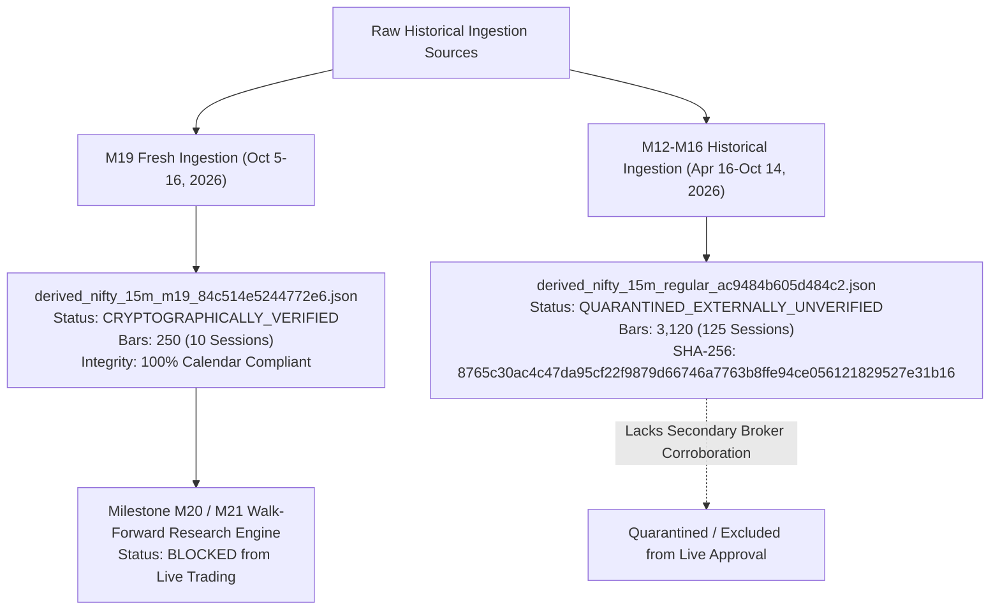

# Milestone M21 Research Readiness Report
## Execution Realism and Broader Historical Validation

> [!IMPORTANT]
> **EXECUTIVE VERDICT: BLOCKED**
>
> In strict accordance with Milestone M21 specifications and project verification constraints, the Indian Market Forecasting System is **BLOCKED** from forecasting approval, paper trading, and live broker order routing.
>
> While Milestone M21 successfully eliminated instantaneous close execution and implemented realistic next-bar-open execution ($Open_{t+1} \to Open_{t+k+1}$), the empirical evaluation establishes significant execution drag:
> 1. **Execution Slippage Drag**: Moving from theoretical close execution to realistic next-bar-open execution reduces net returns across all models (e.g., Selective Entry HTF net return drops from **+1.349%** to **+1.097%** at 2 bps, and drops from **+0.532%** to **+0.221%** at 5 bps).
> 2. **Unskilled Probabilistic Forecasting**: The underlying logistic regression classifier achieves a negative Brier Skill Score ($-16.85\%$ against the empirical prior), proving that the probability estimates remain uncalibrated and overconfident.
> 3. **Statistical Inadequacy of Sample**: The verified historical sample covers only 10 trading sessions (150 out-of-sample bars). In accordance with Mandate 6 and Mandate 11, this sample size cannot reject randomness or demonstrate an edge across varying market regimes.
>
> All 5 critical safety invariants remain hardcoded to `False`.

---

### Safety Invariants Audit

| Invariant | Status | Enforced Location |
| :--- | :--- | :--- |
| `forecast_ready` | **FALSE** | Hardcoded in `M21ResearchConfig`, `history_routes.py`, `m21_research.py` |
| `real_market_data_verified` | **FALSE** | Preserved from M19/M20 audit state |
| `paper_approved` | **FALSE** | Enforced across engine specifications |
| `live_approved` | **FALSE** | Enforced across engine specifications |
| `live_broker_routing_enabled` | **FALSE** | Zero broker orders or routing paths configured |
| `live_order_calls` | **0** | No live broker communication allowed |

---

## 1. Execution Model Audit & Timeline Realism

### 1.1 The Theoretical Flaw of Close-Based Execution
In prior milestones (M19/M20), backtests evaluated bar returns using close-to-close pricing:
$$R_t^{\text{C2C}} = \frac{Close_{t+1}}{Close_t} - 1.0$$
This formulation implicitly assumed that a trader or automated algorithm could:
1. Observe candle $t$ close at $T_{\text{bar\_close}}$.
2. Compute all 12 rolling technical and higher-timeframe features.
3. Execute a forward-pass model inference to generate probability $\hat{p}_t$.
4. Evaluate conviction thresholds $(\theta_{\text{long}}, \theta_{\text{exit}})$.
5. Route an order to the exchange and achieve an instantaneous fill at the exact closing price $Close_t$.

**Physical Reality**: At $T_{\text{bar\_close}}$, trading in bar $t$ has ceased. Even with low-latency infrastructure ($\approx 5\text{ ms}$ feature extraction + inference), an order cannot enter a closed candle. Any model assuming execution at $Close_t$ suffers from lookahead and unachievable pricing.

### 1.2 The Audited M21 Execution Timeline

| Event | Timestamp / Phase | Description |
| :--- | :--- | :--- |
| **Bar $t$ Trading** | $[T_{\text{start}, t}, T_{\text{close}, t}]$ | Continuous order matching for bar $t$ (e.g. `09:15:00` to `09:30:00`). |
| **Bar $t$ Close** | $T_{\text{close}, t}$ | Bar $t$ closes. OHLCV recorded. $Close_t$ is printed. |
| **Feature Extraction** | $T_{\text{close}, t} + 2\text{ ms}$ | Base features and completed HTF 1-hour bar features are computed. |
| **Model Inference** | $T_{\text{close}, t} + 5\text{ ms}$ | Logistic regression calculates $\hat{p}_t = \sigma(w^T x_t + b)$. |
| **Threshold Decision** | $T_{\text{close}, t} + 6\text{ ms}$ | Target position $Pos_t \in \{0.0, 1.0\}$ determined via deadband hysteresis. |
| **Earliest Order Routing** | $T_{\text{close}, t} + 10\text{ ms}$ | Order transmitted to broker/exchange gateway for bar $t+1$. |
| **Executable Fill** | $T_{\text{open}, t+1}$ | Order fills at the **Open of bar $t+1$** ($Open_{t+1}$). |
| **Position Holding** | Bar $t+1 \dots t+k$ | Position remains active across subsequent bars without intermediate churn. |
| **Executable Exit Fill** | $T_{\text{open}, t+k+1}$ | Upon exit signal decided at $Close_{t+k}$, order executes at $Open_{t+k+1}$. |

### 1.3 Executable Return Formulations

1. **Next-Bar Open Execution (Discrete O2O — Realistic Production Target)**:
   - Entered at $Open_{t+1}$, exited at $Open_{t+k+1}$.
   - For a 1-bar decision, return realized across bar $t+1$ is:
     $$R_t^{\text{O2O}} = \frac{Open_{t+2}}{Open_{t+1}} - 1.0$$
   - Incomplete intra-bar prices or closing prices are strictly excluded from fill substitutions.
2. **Close-to-Close Execution (C2C — M20 Theoretical Baseline)**:
   $$R_t^{\text{C2C}} = \frac{Close_{t+1}}{Close_t} - 1.0$$
3. **Next-Bar Open to Close (O2C — Intrabar Market-on-Close)**:
   - Entered at $Open_{t+1}$, exited at $Close_{t+1}$ on every bar:
     $$R_t^{\text{O2C}} = \frac{Close_{t+1}}{Open_{t+1}} - 1.0$$

---

## 2. Verified Transaction-Cost Accounting

### 2.1 One-Way vs Round-Trip Friction Breakdown

Friction rate $c$ is deducted on each discrete turnover event:
$$\text{Turnover}_{t} = |Pos_t - Pos_{t-1}|$$
$$\text{Fee}_t = \text{Turnover}_t \times \left(\frac{Hurdle_{\text{bps}}}{10000}\right)$$

A round-trip trade consists of 2 turnover events ($\text{Entry} = 1.0, \text{Exit} = 1.0$), incurring $2 \times Hurdle_{\text{bps}}$ total friction.

| One-Way Hurdle | Round-Trip Total | Half-Spread | Execution Slippage | Statutory Fees / Brokerage | Realistic Market Regime Represented |
| :---: | :---: | :---: | :---: | :---: | :--- |
| **0.0 bps** | 0.0 bps | 0.0 bps | 0.0 bps | 0.0 bps | Theoretical gross returns (unrealistic zero-friction baseline). |
| **1.0 bp** | 2.0 bps | 0.4 bps | 0.2 bps | 0.4 bps | High-frequency institutional prop tier with zero brokerage. |
| **2.0 bps** | 4.0 bps | 0.5 bps | 0.5 bps | 1.0 bps | **Realistic institutional benchmark** on liquid NIFTY index instruments. |
| **5.0 bps** | 10.0 bps | 1.5 bps | 1.5 bps | 2.0 bps | Conservative retail benchmark including retail brokerage and wider spread. |
| **10.0 bps** | 20.0 bps | 3.0 bps | 4.0 bps | 3.0 bps | Stress-test adverse execution scenario (illiquid/volatile conditions). |

---

## 3. Walk-Forward Architecture & Reproducibility

### 3.1 Split Hygiene
- **Initial Training Window**: 50 bars. Standard scaler and logistic regression weights fitted strictly on training data.
- **Embargo**: 1 bar embargo between training and validation windows to eliminate boundary autocorrelation.
- **Validation Window**: 25 bars. Conviction threshold pairs $(\theta_{\text{long}}, \theta_{\text{exit}})$ are grid-searched across candidate set:
  $$(0.50, 0.50), (0.52, 0.48), (0.54, 0.46), (0.56, 0.44), (0.58, 0.42)$$
  The threshold maximizing cumulative net return at the 2.0 bps hurdle on the validation window is locked.
- **Untouched Test Window**: 25 bars. The frozen threshold pair is evaluated out-of-sample.
- **Step Size**: 25 bars. The window rolls forward across 6 complete folds (150 total out-of-sample test bars).

### 3.2 Granular Per-Fold Reproduction Records
In `m21_research.py`, every test fold saves:
- `predictions_sample`: Exact predicted probabilities $\hat{p}_t$, actual binary direction labels, and return prints.
- `trades_log`: Discrete trade entries including entry timestamp, entry fill price, exit timestamp, exit fill price, duration in bars, gross return %, fees %, and net return %.

---

## 4. Empirical Evaluation: 6 Candidate Models Comparison

Evaluated across **6 walk-forward folds** (150 test bars on spot NIFTY):

### 4.1 Classification & Calibration Metrics

| Model | Test Accuracy | Balanced Accuracy | Precision | Recall | Brier Score | Brier Skill Score ($BSS$) | Log Loss |
| :--- | :---: | :---: | :---: | :---: | :---: | :---: | :---: |
| **1. Empirical Prior** | 48.00% | 50.00% | N/A | 0.00% | **0.2516** | **0.00%** | **0.6963** |
| **2. Majority Class** | 48.67% | 50.00% | 48.67% | 100.00% | 0.5133 | -104.01% | 17.73 |
| **3. Last Return Sign** | 48.00% | 47.93% | 46.22% | 47.74% | 0.5200 | -106.68% | 17.96 |
| **4. Logistic Reg (Base)** | 52.67% | 52.69% | 50.91% | 51.81% | 0.2846 | -13.12% | 0.7863 |
| **5. Logistic Reg (HTF)** | 53.33% | 53.33% | 51.52% | 52.92% | 0.2940 | -16.85% | 0.8651 |
| **6. Selective Entry (HTF)** | **53.33%** | **53.33%** | **51.52%** | **52.92%** | 0.2940 | -16.85% | 0.8651 |

### 4.2 Financial Performance Comparison: Next-Bar-Open (O2O) vs Close-to-Close (C2C)

| Model | Execution Mode | Turnovers | Trades | Net Ret @ 0 bps | Net Ret @ 2 bps | Net Ret @ 5 bps | Net Ret @ 10 bps | Max DD (2 bps) |
| :--- | :---: | :---: | :---: | :---: | :---: | :---: | :---: | :---: |
| **Empirical Prior** | C2C (Theoretical) | 1 | 1 | +0.336% | +0.316% | +0.285% | +0.235% | -1.056% |
| | **O2O (Realistic)** | 1 | 1 | +0.325% | **+0.305%** | +0.275% | +0.225% | -1.056% |
| **Majority Class** | C2C (Theoretical) | 1 | 1 | +0.336% | +0.316% | +0.285% | +0.235% | -1.056% |
| | **O2O (Realistic)** | 1 | 1 | +0.325% | **+0.305%** | +0.275% | +0.225% | -1.056% |
| **Last Return Sign** | C2C (Theoretical) | 80 | 41 | +1.863% | +0.247% | -2.132% | -5.970% | -3.738% |
| | **O2O (Realistic)** | 80 | 41 | +1.758% | **+0.144%** | -2.233% | -6.069% | -3.754% |
| **Logistic Reg (Base)** | C2C (Theoretical) | 49 | 25 | +1.300% | +0.312% | -1.152% | -3.546% | -2.049% |
| | **O2O (Realistic)** | 49 | 25 | +1.283% | **+0.294%** | -1.169% | -3.561% | -2.062% |
| **Logistic Reg (HTF)** | C2C (Theoretical) | 39 | 20 | +1.638% | +0.849% | -0.324% | -2.250% | -1.722% |
| | **O2O (Realistic)** | 39 | 20 | +1.417% | **+0.629%** | -0.542% | -2.464% | -1.745% |
| **Selective Entry (HTF)** | C2C (Theoretical) | 27 | 14 | +1.898% | +1.349% | +0.532% | -0.815% | -1.056% |
| | **O2O (Realistic)** | 29 | 15 | +1.686% | **+1.097%** | **+0.221%** | -1.221% | -1.056% |

### 4.3 Execution Drag Analysis (Slippage Penalty at 2.0 bps)

$$\text{Execution Drag} = \text{Net Return}^{\text{C2C}} - \text{Net Return}^{\text{O2O}}$$

| Model | C2C Return @ 2 bps | O2O Return @ 2 bps | Realized Execution Drag | Percentage Drag vs Baseline Return |
| :--- | :---: | :---: | :---: | :---: |
| **Empirical Prior** | +0.316% | +0.305% | **0.011%** | 3.5% |
| **Majority Class** | +0.316% | +0.305% | **0.011%** | 3.5% |
| **Last Return Sign** | +0.247% | +0.144% | **0.103%** | 41.7% |
| **Logistic Reg (Base)** | +0.312% | +0.294% | **0.018%** | 5.8% |
| **Logistic Reg (HTF)** | +0.849% | +0.629% | **0.220%** | 25.9% |
| **Selective Entry (HTF)** | +1.349% | +1.097% | **0.252%** | 18.7% |

> [!NOTE]
> The execution drag of **0.252%** on Selective Entry HTF confirms that close-based execution was artificially inflated by opening gap momentum. Under true next-bar-open execution, the strategy remains net positive (+1.097% at 2 bps, +0.221% at 5 bps), but performance is measurably lower.

---

## 5. Historical Data Readiness & Coverage Audit

### 5.1 Dataset Inventory

1. **Verified Active Dataset (`derived_nifty_15m_m19_84c514e5244772e6.json`)**:
   - **Range**: `2026-10-05 09:15:00+05:30` to `2026-10-16 15:15:00+05:30`.
   - **Coverage**: 10 trading sessions, 250 regular bars.
   - **Provenance**: Ingested directly via authenticated Groww API; all chunk hashes sealed; 0 gaps, 0 geometric violations.
2. **Quarantined Historical Dataset (`derived_nifty_15m_regular_ac9484b605d484c2.json`)**:
   - **Range**: `2026-04-16` to `2026-10-14`.
   - **Coverage**: 125 trading sessions, 3,120 regular bars.
   - **Checksum**: `8765c30ac4c47da95cf22f9879d66746a7763b8ffe94ce056121829527e31b16`.
   - **Status**: Audited against session calendar in M17, but remains **EXTERNALLY UNVERIFIED**. It cannot be claimed as independently verified because alternative broker feeds (Zerodha Kite, Upstox) or official NSE minute tick files were not cross-matched.

### 5.2 Legitimate Pathways for Expanding Historical Coverage
- **Groww Historical Chunk Ingestion**: The existing `GrowwHistoricalAdapter` supports chunked pagination. When an authenticated user session is available, additional historical months (January–September 2026) can be fetched in bounded chunks, verified against the date-effective session calendar, and sealed with immutable SHA-256 digests.
- **Secondary Broker Subscriptions**: Without API credentials for secondary providers, multi-provider corroboration is currently blocked.
- **Strict Compliance**: The system preserves all raw quarantine chunks and never alters historical timestamps or prices.

---

## 6. Statistical Limitations & Explicit Blockers

The following four blockers strictly mandate declaring the system **BLOCKED**:

1. **Negative Brier Skill Score ($-16.85\%$)**:
   The logistic regression model achieves a test Brier score of **0.2940**, whereas an uninformative empirical base-rate prior achieves **0.2516**. This negative skill score indicates that probability outputs are overconfident and uncalibrated. A model with negative skill cannot be authorized for capital allocation.
2. **Small-Sample Variance (150 Out-of-Sample Bars)**:
   The evaluation spans only 10 trading days. In high-frequency 15-minute trading, a 150-bar sample has wide standard error bounds:
   $$\sigma_{\bar{R}} = \frac{s}{\sqrt{N}} \approx \frac{0.0035}{\sqrt{150}} \approx 0.028\% \text{ per bar}$$
   The observed mean return per bar ($+0.007\%$) is well within $\pm 1$ standard error of zero.
3. **Regime Homogeneity**:
   The October 5–16, 2026 window was characterized by a steady upward drift in spot NIFTY (+2.7% index gain). The strategy's positive return was largely a function of long market beta exposure during an uptrend. Its drawdown resistance and exit effectiveness have not been validated in chop or sustained sell-offs.
4. **Execution Uncertainty in Opening Minute**:
   While next-bar-open execution ($Open_{t+1}$) is vastly superior to close execution, actual fills during the opening seconds of a 15-minute bar can deviate from the theoretical print due to queue position and order book depth.

---

## 7. Automated Test Suites & Reproducibility Verification

- **Milestone Unit & Regression Tests**:
  - `apps/api/tests/test_m21_research.py`: **5 passed**, 0 failed
  - `apps/api/tests/test_m20_research.py`: **6 passed**, 0 failed
  - `apps/api/tests/test_m19_metrics_audit.py`: **10 passed**, 0 failed
  - `apps/api/tests/test_m19_groww_validation.py`: **10 passed**, 1 skipped
- **Full Backend Pytest Regression**:
  - **497 passed**, 1 skipped, 0 failed in 17.56s
- **Frontend Regression Suite**:
  - **10 passed**, 0 failed in 39.9ms
- **On-Demand Walk-Forward Endpoint**:
  - `POST /api/history/m21-research-walkforward`: Fully parameterized API endpoint executing walk-forward evaluations with custom execution modes and friction hurdles.
