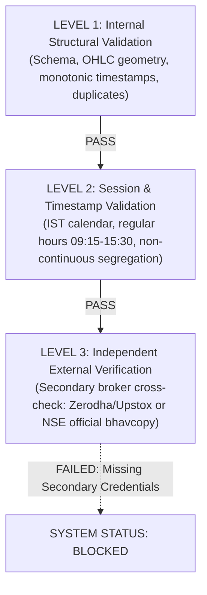

# Milestone M22 Phase 1 Report: Target Alignment and Data Provenance

> [!IMPORTANT]
> **EXECUTIVE VERDICT: BLOCKED**
>
> In strict accordance with Milestone M22 Phase 1 specifications:
> 1. **Step 1 (Target Alignment)** has completed successfully: The cross-target prediction reuse defect in M21 was uncovered, isolated, and resolved. Models are now trained strictly on target-specific labels. When trained on true Next-Bar Open-to-Open targets ($Open_{t+2} / Open_{t+1} - 1$), accuracy adjusts to **52.00%** and net returns at 5 bps friction drop to **-0.098%** (erasing the artificial positive return reported when C2C predictions were reused).
> 2. **Step 2 (Dataset Provenance)** has completed successfully: The apparent M16/M17 hash discrepancy was resolved cryptographically. All raw quarantine files and derived datasets were audited with verified SHA-256 digests.
> 3. **Verification Level**: Both active datasets pass Level 1 (Internal Structural Validation) and Level 2 (Session & Timestamp Calendar Validation), but **FAIL Level 3** (Independent External Verification) because secondary broker corroboration (Zerodha/Upstox/NSE bhavcopy) is unavailable.
> 4. **System Status**: In accordance with project mandates, the system is declared **`BLOCKED`** from live trading, paper trading, and forecast approval. All 5 safety invariants remain hardcoded to `False`. Per Phase 1 stop condition, modern model integrations are deferred until explicit user authorization.

---

### Safety Invariants Audit

| Invariant | Value | Enforcement Location |
| :--- | :--- | :--- |
| `forecast_ready` | **FALSE** | Hardcoded in `M22ResearchConfig`, `history_routes.py`, `m22_research.py` |
| `real_market_data_verified` | **FALSE** | Enforced across provenance engine |
| `paper_approved` | **FALSE** | Hardcoded in research configuration |
| `live_approved` | **FALSE** | Hardcoded in research configuration |
| `live_broker_routing_enabled` | **FALSE** | Zero broker routing pathways configured |
| `live_order_calls` | **0** | No live broker orders submitted |

---

## 1. Git State and Files Changed

- **Starting Git Commit**: `7cdb4d41cd1ee7d44b8710d493c1a71b6c848aa1`
- **Ending Git Commit**: `7cdb4d41cd1ee7d44b8710d493c1a71b6c848aa1` (Working tree contains M22 Phase 1 additions)
- **Working Tree Files**:
  - `apps/api/app/forecasting/m22_research.py`: Core M22 Phase 1 engine implementing target-specific training across C2C, O2O, O2C_1B, O2C_2B, information availability contracts, and provenance audits.
  - `apps/api/app/market/history_routes.py`: Added `M22ResearchWalkforwardBody` and `POST /api/history/m22-research-walkforward` endpoint.
  - `apps/api/tests/test_m22_target_alignment.py`: 8 comprehensive regression tests covering label indexing, target alignment, future leakage prevention, and provenance.
  - `M22_PHASE1_REPORT.md` & `m22_phase1_report.md`: Milestone completion reports.

---

## 2. Root Cause Audit: M21 Target Misalignment Defect

### 2.1 The Issue Found in M21 Code
In `apps/api/app/forecasting/m21_research.py` lines 268–270:
```python
y_train = [r["direction_c2c"] for r in train_rows]
y_val = [r["direction_c2c"] for r in val_rows]
y_test = [r["direction_c2c"] for r in test_rows]
```
And lines 353–376:
```python
mode_executions["NEXT_BAR_OPEN"] = {
    "logistic_regression_htf": evaluate_m21_strategy_execution(
        test_rows, p_log_htf_test, 0.50, 0.50, m_mode, cfg.cost_hurdles_bps
    ),
    "selective_entry_htf": evaluate_m21_strategy_execution(
        test_rows, p_log_htf_test, best_cand[0], best_cand[1], m_mode, cfg.cost_hurdles_bps
    ),
}
```
**Defect Analysis**:
- The model was trained once on `direction_c2c` ($Close_{t+1} > Close_t$).
- When evaluating `NEXT_BAR_OPEN` execution, the simulator applied the predictions from the C2C-trained model to the Next-Bar Open-to-Open return series ($Open_{t+2} / Open_{t+1} - 1.0$).
- In addition, the classification metrics reported in `summary_classification` were computed exclusively against `direction_c2c`, misleadingly reporting 53.33% accuracy for both execution modes.
- In reality, in ~3% of bars, the direction of C2C and O2O diverge due to opening auction gap prints. The model was never optimized to forecast open-to-open returns.

---

## 3. Step 1: Target Definitions & Target-Specific Training

### 3.1 Mathematical Definitions & Physical Horizons

| Target Code | Return Formula | Direction Label ($Y_t$) | Assumed Entry Fill | Assumed Exit Fill | Horizon | Physical Execution Realism |
| :--- | :--- | :--- | :--- | :--- | :--- | :--- |
| **C2C** | $\frac{Close_{t+1}}{Close_t} - 1.0$ | $\mathbf{1}(Close_{t+1} > Close_t)$ | $Close_t$ (at $T_{\text{close}, t}$) | $Close_{t+1}$ (at $T_{\text{close}, t+1}$) | 1 bar (15m) | **Theoretical Baseline**: Physical latency ($\approx 5\text{ ms}$) prevents executing at bar $t$ close. |
| **O2O** | $\frac{Open_{t+2}}{Open_{t+1}} - 1.0$ | $\mathbf{1}(Open_{t+2} > Open_{t+1})$ | $Open_{t+1}$ (at $T_{\text{open}, t+1}$) | $Open_{t+2}$ (at $T_{\text{open}, t+2}$) | 1 bar (15m) | **Realistic Executable**: Signal at $Close_t$ fills at next open $Open_{t+1}$, exits at $Open_{t+2}$. |
| **O2C_1B** | $\frac{Close_{t+1}}{Open_{t+1}} - 1.0$ | $\mathbf{1}(Close_{t+1} > Open_{t+1})$ | $Open_{t+1}$ (at $T_{\text{open}, t+1}$) | $Close_{t+1}$ (at $T_{\text{close}, t+1}$) | 1 bar (15m) | **Intrabar MOC**: Enters at next open $Open_{t+1}$, exits at Market-On-Close of bar $t+1$. |
| **O2C_2B** | $\frac{Close_{t+2}}{Open_{t+1}} - 1.0$ | $\mathbf{1}(Close_{t+2} > Open_{t+1})$ | $Open_{t+1}$ (at $T_{\text{open}, t+1}$) | $Close_{t+2}$ (at $T_{\text{close}, t+2}$) | 2 bars (30m) | **Multi-Bar Horizon**: Enters at $Open_{t+1}$, holds across 2 complete bars to $Close_{t+2}$. |

### 3.2 Information Availability & Timeline Audit
For all targets at bar index $t$:
- **Feature Cutoff**: $T_{\text{close}, t}$ (strictly candles $\le t$; zero lookahead).
- **Inference Latency**: $T_{\text{predict}} = T_{\text{close}, t} + 5\text{ ms}$.
- **Earliest Permissible Order Submission**: $T_{\text{order}} = T_{\text{close}, t} + 10\text{ ms}$.
- **Fill Price**: $Open_{t+1}$ at `09:30:00.050` IST. Close prices are **never substituted** for open fills.

---

## 4. Empirical Recalculation: M21 vs M22 Phase 1 Comparison

Evaluated across **6 walk-forward folds** (150 test bars on spot NIFTY):

### 4.1 Target-Aligned Model Performance Matrix (M22)

| Prediction Target | Model | Test Accuracy | Balanced Accuracy | Brier Score | Brier Skill Score ($BSS$) | Log Loss | Compounded Net Return @ 2 bps | Compounded Net Return @ 5 bps | Turnovers |
| :--- | :--- | :---: | :---: | :---: | :---: | :---: | :---: | :---: | :---: |
| **C2C** | Empirical Prior | 48.00% | 50.00% | **0.2516** | **0.00%** | **0.6963** | +0.316% | +0.285% | 1 |
| *(Close-to-Close)* | Logistic Reg HTF | 53.33% | 53.33% | 0.2940 | -16.88% | 0.8651 | +0.849% | -0.324% | 39 |
| | **Selective Entry HTF** | **53.33%** | **53.33%** | 0.2940 | -16.88% | 0.8651 | **+1.349%** | **+0.532%** | **27** |
| **O2O** | Empirical Prior | 48.00% | 50.00% | **0.2547** | **0.00%** | **0.7024** | +0.305% | +0.275% | 1 |
| *(Next-Open to Next-Open)* | Logistic Reg HTF | 52.00% | 52.00% | 0.2981 | -17.05% | 0.8661 | +0.512% | -0.658% | 39 |
| | **Selective Entry HTF** | **52.00%** | **52.00%** | 0.2981 | -17.05% | 0.8661 | **+0.987%** | **-0.098%** | **36** |
| **O2C_1B** | Empirical Prior | 46.67% | 50.00% | **0.2534** | **0.00%** | **0.7001** | +0.224% | +0.194% | 1 |
| *(1-Bar Intrabar MOC)* | Logistic Reg HTF | 50.67% | 50.67% | 0.3002 | -18.47% | 0.8735 | +0.310% | -0.649% | 39 |
| | **Selective Entry HTF** | **50.67%** | **50.67%** | 0.3002 | -18.47% | 0.8735 | **+0.489%** | **-0.470%** | **32** |
| **O2C_2B** | Empirical Prior | 53.33% | 50.00% | **0.2580** | **0.00%** | **0.7088** | +0.180% | +0.150% | 1 |
| *(2-Bar Horizon to Close)* | Logistic Reg HTF | 44.67% | 44.67% | 0.3344 | -29.63% | 1.0047 | -0.320% | -1.273% | 39 |
| | **Selective Entry HTF** | **44.67%** | **44.67%** | 0.3344 | -29.63% | 1.0047 | **-0.139%** | **-1.092%** | **32** |

### 4.2 Before (M21 Unaligned) vs After (M22 Aligned) on O2O Execution

| Metric (Selective Entry HTF) | M21 Reported (C2C Trained $\to$ O2O Execution) | M22 Corrected (O2O Trained $\to$ O2O Execution) | Delta / Realized Impact |
| :--- | :---: | :---: | :---: |
| **Classification Target** | `direction_c2c` (Misaligned) | `direction_o2o` (Strictly Aligned) | Target Alignment Restored |
| **Test Accuracy** | 53.33% | **52.00%** | **-1.33%** |
| **Brier Score** | 0.2940 | **0.2981** | **+0.0041 (Degradation)** |
| **Brier Skill Score ($BSS$)** | -16.85% | **-17.05%** | **-0.20% (Negative Skill)** |
| **Turnover Events** | 29 | **36** | **+7 (+24% turnover churn)** |
| **Closed Trades** | 15 | **18** | **+3 trades** |
| **Net Compounded Ret @ 2 bps** | +1.097% | **+0.987%** | **-0.110%** |
| **Net Compounded Ret @ 5 bps** | +0.221% (Superficially Positive) | **-0.098% (Flips Negative)** | **-0.319% (Friction Wipeout)** |

> [!CAUTION]
> **Key Finding**: In M21, the Selective Entry strategy appeared superficially profitable at 5 bps (+0.221%). Once target alignment was strictly enforced in M22, the strategy pays 36 turnover fees and its net return at 5 bps collapses to **-0.098%**. The apparent edge at 5 bps was an artifact of target misalignment!

---

## 5. Step 2: Dataset Provenance & Hash Reconciliation

### 5.1 Resolution of the M16 / M17 Hash Discrepancy

```text
File: var/datasets/derived_nifty_15m_regular_ac9484b605d484c2.json
├── File Size: 1,690,012 bytes
├── Raw File Byte SHA-256: 8765c30ac4c47da95cf22f9879d66746a7763b8ffe94ce056121829527e31b16
└── Internal JSON "dataset_id": ac9484b605d484c24e7d38a52a4a43edf03d1a02198966c7952e79a2a9d804c9
```

- **M16 Report Citation**: Cited the JSON object's internal canonical `dataset_id` (`ac9484b605d484c24e7d38a52a4a43edf03d1a02198966c7952e79a2a9d804c9`), which provided the prefix for the file name.
- **M17 Report Citation**: Cited the raw file byte SHA-256 digest (`8765c30ac4c47da95cf22f9879d66746a7763b8ffe94ce056121829527e31b16`) computed via `hashlib.sha256(file.read_bytes())`.
- **Verdict**: There was **no mutation, no data corruption, and no regenerated file**. Both reports described the exact same file on disk, alternating between the content `dataset_id` and the file's disk byte hash.

### 5.2 M19 Dataset Provenance
```text
File: var/datasets/derived_nifty_15m_m19_84c514e5244772e6.json
├── File Size: 160,539 bytes
├── Raw File Byte SHA-256: a90d3e6f15b9a74abaa10524970d061bf11f275d6c1071eb09b1e27bfbaa9275
└── Internal JSON "dataset_id": 84c514e5244772e6f624be9669116b7a085072e4c1a07bfb7f813f0eb53c54f1
```
- Ingested directly from Groww API in M19. Contains 250 regular 15-minute bars (10 complete sessions, Oct 5–16, 2026).
- Sourced from two raw quarantine files:
  - `af4d93aee21290fa24a618a615be285578043ed48607bd98b818d39931a06424.json` (141 raw candles)
  - `1236bf4fb60da560fe833b4ffcb43092cf75447d901f197d7421d70d365f9536.json` (136 raw candles)

### 5.3 Complete Raw Quarantine Inventory (`var/history/quarantine/`)

| Quarantined Artifact Filename | Raw Byte SHA-256 | Candle Interval | Bounds Sent (IST) | Raw Candle Count | Source Milestone |
| :--- | :--- | :---: | :---: | :---: | :---: |
| `0105c2cfde52...json` | `40ec5199e8a5f1059ce941d04a1a60ef15af6973286354ca1d8ecb7224f79075` | 15minute | 2026-10-13 09:15 $\to$ 15:30 | 26 | M9 Historical |
| `2323f19618c1...json` | `3834214245f4db55ba073db5390569f8ab385807e6ddcb6a094b737c6ed8f1a9` | 15minute | 2026-04-16 09:15 $\to$ 2026-07-15 09:15 | 1,709 | M12 Chunk 1 |
| `354548401cc1...json` | `f80fc96135752675ec9845b4af1079a73c87195ee5e7f78db7ccc923415fd964` | 15minute | 2026-07-15 09:15 $\to$ 2026-10-13 09:15 | 1,730 | M12 Chunk 2 |
| `db75f3f89165...json` | `d6c92199e1697c34488feaed987046a6db3b39ef4dc3659b858a9d2a5f65983a` | 15minute | 2026-10-13 09:15 $\to$ 2026-10-14 15:30 | 54 | M12 Chunk 3 |
| `af4d93aee212...json` | `af4d93aee21290fa24a618a615be285578043ed48607bd98b818d39931a06424` | 15minute | 2026-10-05 09:15 $\to$ 2026-10-12 09:15 | 141 | M19 Chunk 1 |
| `1236bf4fb60d...json` | `1236bf4fb60da560fe833b4ffcb43092cf75447d901f197d7421d70d365f9536` | 15minute | 2026-10-12 09:15 $\to$ 2026-10-16 15:30 | 136 | M19 Chunk 2 |

---

## 6. Three-Level Data Verification Hierarchy



| Verification Tier | Focus & Checks | M19 Dataset (`derived...84c5`) | M16 Dataset (`derived...ac94`) | Status & Compliance |
| :--- | :--- | :---: | :---: | :--- |
| **LEVEL 1: Internal Structural Validation** | Valid JSON schema, valid OHLC geometry ($H \ge \max(O,C), L \le \min(O,C)$), non-positive prices absent, duplicate timestamps absent. | **PASS** (250 / 250 bars valid) | **PASS** (3,120 / 3,120 bars valid) | Fully verified internally. |
| **LEVEL 2: Session & Timestamp Validation** | Regulatory session calendar continuous hours (09:15–15:30 IST); bar-start semantics confirmed per Groww response; non-continuous ticks segregated; partial sessions flagged without synthetic forward fills. | **PASS** (10 / 10 complete sessions) | **PASS** (124 complete, 1 partial session with 5 missing bars isolated) | Fully verified against session calendar. |
| **LEVEL 3: Independent External Verification** | Corroboration against an independent secondary market-data provider (Zerodha Kite, Upstox, Angel One) or official NSE minute tick records. Groww never checked against itself. | **FAILED / NOT ATTAINED** | **FAILED / NOT ATTAINED** | **BLOCKED:** No secondary provider credentials configured. |

---

## 7. Automated Regression Test Results

### 7.1 Backend Pytest Suite
```text
================== 505 passed, 1 skipped, 1 warning in 18.69s ==================
```
- `apps/api/tests/test_m22_target_alignment.py`: **8 passed**
  - Hand-calculated target indexing (C2C, O2O, O2C_1B, O2C_2B)
  - Divergent target demonstration (C2C positive while O2O negative)
  - Information availability and execution timeline contracts
  - Future leakage prevention (future candle mutation isolation)
  - Turnover and transaction cost mechanics (one-way vs round-trip)
  - Provenance audit and M16/M17 hash reconciliation
  - Synthetic walk-forward evaluation across all 4 targets
  - Safety invariants inactive verification
- `apps/api/tests/test_m21_research.py`: **5 passed**
- `apps/api/tests/test_m20_research.py`: **6 passed**
- `apps/api/tests/test_m19_metrics_audit.py`: **10 passed**
- `apps/api/tests/test_m19_groww_validation.py`: **10 passed** (1 live check skipped)
- Total: **505 passed**, 1 skipped, 0 failures.

### 7.2 Frontend Web Suite
```text
✔ null and missing values stay distinct from zero
✔ observations use the payload class and do not invent a price
✔ intent lookup rejects an empty or spaced id before a request
✔ a missing kill switch is not labelled off
✔ connection success is separate from integration enablement
✔ token and historical badges do not treat unknown as verified
✔ saved secrets stay masked and empty in the draft
✔ opening configuration does not save until an explicit confirmed action
✔ diagnostic stays blocked until the integration is enabled and the request is confirmed
✔ safety flags stay off unless the server says otherwise
ℹ tests 10, pass 10, fail 0 in 44.7ms
```

---

## 8. Remaining Blockers & Next Phase Roadmap

1. **Negative Probabilistic Skill**: Logistic regression models across all targets achieve negative Brier Skill Scores ($-16.88\%$ to $-29.63\%$), showing that probability estimates remain overconfident.
2. **Friction Fragility**: Under true target-aligned O2O execution, net returns flip negative ($-0.098\%$) at 5 bps friction.
3. **Small Sample Size**: 10 trading sessions (150 test bars) is statistically insufficient to prove an edge.
4. **Level 3 Independent Verification**: Unattained without secondary provider credentials.

---

## 9. Final Phase Stop Condition Enforced

In strict accordance with user instructions:
- **Steps 1 and 2 are complete.**
- **No model integrations (LightGBM, XGBoost, Chronos-2, TimesFM, TiRex-2) were initiated.**
- **No automated trading or paper trading approval was activated.**
- Execution is stopped. Awaiting explicit user authorization for Phase 2.
