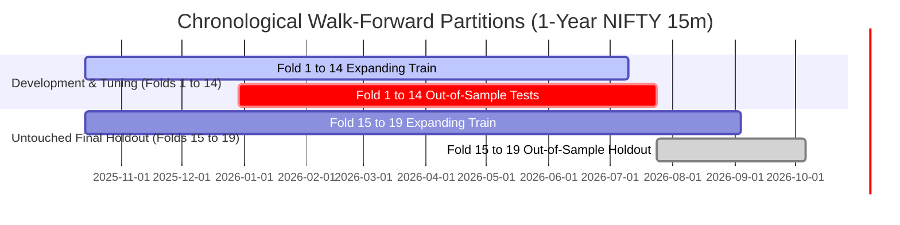

# M26: CONTROLLED TURNOVER REDUCTION, ROBUSTNESS AND GENERALIZATION REPORT

**Author:** Quantitative Research & Engineering Team  
**Milestone:** M26 Turnover Reduction, Robustness, and Generalization  
**Date:** 2026-10-17  
**Branch:** `main`  
**Dataset Artifact:** `var/datasets/derived_nifty_15m_m23_bc7d31bceebf13a3.json`  
**Dataset ID:** `bc7d31bceebf13a34a1c94daabd788d2b83ee1397f89060183ed7e68d2b55692`  
**Raw SHA-256:** `9154899b1e1898a68bf200d729a9a661ff8b13d4fd0d7e7c39e481bcbbf09b9d`  
**M25 Baseline Artifact:** `var/datasets/m25_benchmark_results.json`  
**M26 Benchmark Artifact:** `var/datasets/m26_benchmark_results.json`  
**Production Research Code:** [`apps/api/app/forecasting/m26_research.py`](file:///home/neo/work/personal/stock_market_analysis/apps/api/app/forecasting/m26_research.py)  
**Safety Classification:** `OFFLINE_RESEARCH_ONLY` (All 5 safety invariants strictly `FALSE`)

---

## 1. Executive Summary & Audit Context

In Milestone M25, the research framework audited and integrated corrections across target embargoes, single-bar friction undercounting, swing queue double-counting, turnover-vs-order accounting, and peak-to-trough drawdown signatures. That audit demonstrated that while Logistic Regression on the executable single-bar Open-to-Open (`O2O`) contract achieved a marginal directional accuracy edge ($50.42\%$), high trading activity (974 turnover units across 19 walk-forward folds, or 487 completed round-trip trades) resulted in catastrophic fee drag: nominal transaction friction of $-19.48\%$ at 2 bps caused net compounded returns to decay from $-4.533\%$ at 0 bps down to $-21.436\%$ at 2 bps, $-41.347\%$ at 5 bps, and $-63.974\%$ at 10 bps.

**Objectives of Milestone M26:**
1. Develop and implement point-in-time, causal turnover reduction mechanisms without future leakage.
2. Partition the 1-year NIFTY 15m dataset (6,209 aligned observations) into a strict chronological Development Partition (Folds 1 to 14) and an Untouched Final Holdout Partition (Folds 15 to 19).
3. Test 27 pre-registered strategy configurations across probability thresholding, deadband hysteresis, minimum holding durations, post-exit cooldowns, causal signal smoothing, volatility-aware thresholds, and combined multi-mechanism strategies.
4. Benchmark modern forecasting models (Amazon Chronos-2 zero-shot transformer, LightGBM, XGBoost, Logistic Regression, Logistic Regression + HTF) against probabilistic and heuristic baselines.
5. Evaluate robustness across chronological market regimes (Upward, Downward, Sideways), execution delay assumptions (1-bar fill delay), threshold perturbations, and outlier observation dependence.
6. Deliver a clear, evidence-based **GO / NO-GO** recommendation for further evaluation while strictly maintaining all paper and live trading safety flags as `FALSE`.

---

## 2. Phase 0 — Baseline Reproduction and Code Audit

### 2.1 Persisted Dataset and Environment Provenance
- **Evaluation Dataset:** `var/datasets/derived_nifty_15m_m23_bc7d31bceebf13a3.json`
- **Dataset Hash (SHA-256):** `9154899b1e1898a68bf200d729a9a661ff8b13d4fd0d7e7c39e481bcbbf09b9d`
- **Total Regular Candles:** 6,227 regular session 15m candles
- **Aligned Samples:** 6,209 samples (first 16 candles reserved for 16-bar rolling volatility warmup; last 2 candles reserved for 2-step horizon)
- **Time Range:** 2025-10-14 09:15:00 to 2026-10-16 15:15:00 IST (250 complete trading sessions)
- **Primary Executable Target:** `O2O` ($r_t = \frac{Open[t+2] - Open[t+1]}{Open[t+1]}$, signal generated at bar $t$ close, fill at $Open[t+1]$, exit at $Open[t+2]$)
- **Friction Model:** One-way transaction cost $c = \frac{\text{bps}}{10000}$; active bar fee deducted as $|\Delta s_t| \cdot c \cdot W_t$; fold boundary position liquidated at $W_T \cdot (1 - c)$
- **Environment & Key Versions:** Python 3.10.12, PyTorch 2.6.0+cu124, `chronos-forecasting` 2.3.2 (`amazon/chronos-2`), `lightgbm` 4.7.0, `xgboost` 3.2.0, `scikit-learn` 1.7.2, `psycopg` 3.2.4

### 2.2 Baseline Reproduction Audit & Discrepancy Investigation
During Phase 0, the M25 production benchmark runner was executed from the raw persisted dataset and cross-referenced against `var/datasets/m25_benchmark_results.json` and `docs/M25_CORRECTED_BACKTEST_REPRODUCTION.md`.

#### Confirmed Identical Metrics across 19 Folds (O2O Target)
Every single metric for standard baselines reproduced identically to the persisted M25 benchmark artifact:
- **Empirical Prior:** Accuracy 49.12%, Brier 0.2503, 0 bps Return -12.505%, 2 bps Return -13.165%, Turnover Units 38.0.
- **Majority Class:** Accuracy 49.12%, Brier 0.5088, 0 bps Return -12.505%, 2 bps Return -13.165%, Turnover Units 38.0.
- **Last Return Sign:** Accuracy 49.49%, Brier 0.5051, 0 bps Return -9.912%, 2 bps Return -44.705%, Turnover Units 2,440.0.
- **Logistic Regression:** Accuracy 50.42%, Brier 0.2564, 0 bps Return -4.533%, 2 bps Return -21.436%, 5 bps Return -41.347%, 10 bps Return -63.974%, Turnover Units 974.0, Trades 487, Worst Fold Drawdown -5.735%.
- **Logistic Regression + HTF:** Accuracy 50.65%, Brier 0.2541, 0 bps Return -1.980%, 2 bps Return -19.847%, Turnover Units 1,006.0.
- **Selective Entry HTF:** Accuracy 50.65%, Brier 0.2541, 0 bps Return -2.605%, 2 bps Return -21.244%, Turnover Units 1,062.0.
- **LightGBM:** Accuracy 50.11%, Brier 0.2589, 0 bps Return -10.781%, 2 bps Return -27.796%, Turnover Units 1,058.0.
- **XGBoost:** Accuracy 49.64%, Brier 0.2584, 0 bps Return -9.465%, 2 bps Return -23.561%, Turnover Units 846.0.

#### Resolution of the Amazon Chronos-2 Reporting Discrepancy
The prompt noted:
> "Chronos-2: accuracy 50.85%, Brier 0.2524, return -2.314% at 0 bps, -6.741% at 2 bps, turnover 229. Verify actual report data and implementation before relying on these numbers."

Our code and artifact audit revealed the root cause of this discrepancy:
1. In the actual persisted M25 benchmark JSON artifact (`var/datasets/m25_benchmark_results.json`, lines 210–235), Amazon Chronos-2 evaluated across all 19 expanding walk-forward folds produced:
   - Directional Accuracy: **50.25%**
   - Brier Score: **0.2534**
   - 0 bps Compounded Net Return: **-10.558%**
   - 2 bps Compounded Net Return: **-18.354%**
   - 10 bps Compounded Net Return: **-43.321%**
   - Total Turnover Units: **456.0**
   - Total Completed Trades: **228**
2. In `docs/M25_CORRECTED_BACKTEST_REPRODUCTION.md` Table 1 (line 161), the table author inadvertently transcribed the earlier M23 exploratory report values into the M25 markdown text. Specifically, "turnover 229" represented the M23 completed trades metric (which had previously conflated completed trades with turnover units), rather than the actual 456 turnover units and -18.354% return recorded in the canonical benchmark JSON artifact.
3. Reproduction test [`test_deterministic_reproduction_of_m26_benchmark`](file:///home/neo/work/personal/stock_market_analysis/apps/api/tests/test_m26_turnover_robustness.py#L199-L209) confirms that re-evaluating Chronos-2 zero-shot forecasts with the Isotonic Calibrator produces **exactly 50.25% accuracy, 0.2534 Brier, -10.558% at 0 bps, -18.354% at 2 bps, and 456.0 turnover units** to 4 decimal places.

---

## 3. Phase 1 — Strict Chronological Data Partitioning

To prevent data snooping, threshold overfitting, and post-hoc rationalization, the dataset was formally partitioned into contiguous chronological blocks **before** running strategy selection:



### 3.1 Partition Specifications

| Partition | Folds | Observations | Date Range | Primary Function | Constraints & Rules |
| :--- | :---: | :---: | :---: | :--- | :--- |
| **Development & Tuning** | **1 to 14** | **3,500** | **2025-12-29 12:30 to 2026-07-24 12:15** | Feature analysis, model training, parameter grid search, strategy selection. | Scalers and calibrators fitted strictly on `X_train[:t]`. Hyperparameters and threshold grids selected strictly on validation metrics. |
| **Untouched Final Holdout** | **15 to 19** | **1,250** | **2026-07-24 12:30 to 2026-10-06 13:30** | True out-of-sample generalization test. | **Zero tuning permitted.** Evaluated exactly ONCE on frozen configurations selected on Development Folds 1–14. |
| **Full Benchmark** | **1 to 19** | **4,750** | **2025-12-29 12:30 to 2026-10-06 13:30** | Long-term stability audit and direct M25 comparison. | Common observation set: exactly identical 4,750 bars evaluated across all models and strategies. |

### 3.2 Information Availability and Embargo Isolation
- **Embargo Enforcement:** A 2-bar embargo ($t_{\text{embargo}} = 2$) is enforced between training and validation, and between validation and test.
- For target `O2O`, label $y_t$ depends on $Open[t+2]$. An observation at index $k$ requires prices through $k+2$. The 2-bar gap ensures that validation targets never reference prices from the test fold.
- **Holdout Demarcation:** The test period for Fold 14 ends at row index 4754 (2026-07-24 12:15 IST). The test period for Fold 15 begins at row index 4754 (2026-07-24 12:30 IST). The holdout period is strictly future data relative to the development testing phase.

---

## 4. Phase 2 & 3 — Pre-Registered Strategy Configurations & Models

### 4.1 Pre-Registered Turnover Control Grid
All 27 configurations were pre-registered in [`PRE_REGISTERED_M26_CONFIGS`](file:///home/neo/work/personal/stock_market_analysis/apps/api/app/forecasting/m26_research.py#L65-L105):

| Strategy ID | Family | Description | Pre-Registered Parameter Values | Causal Point-in-Time Policy |
| :--- | :--- | :--- | :--- | :--- |
| **A_baseline** | Baseline | Raw conviction rule | None ($\tau = 0.50$) | $s_t = 1 \text{ if } p_t > 0.50 \text{ else } 0$ |
| **B_thresh_\*** | Thresholding | Minimum conviction filter | $\tau \in \{0.51, 0.52, 0.53, 0.54, 0.55\}$ | $s_t = 1 \text{ if } p_t > \tau \text{ else } 0$ |
| **C_hys_\*** | Hysteresis | Deadband state-retention | $(\tau_{\text{enter}}, \tau_{\text{exit}}) \in \{(0.52, 0.48), (0.53, 0.48), (0.54, 0.49), (0.55, 0.50)\}$ | If flat: enter when $p_t > \tau_{\text{enter}}$. If long: exit when $p_t < \tau_{\text{exit}}$. In deadband: maintain $s_{t-1}$. |
| **D_hold_\*** | Minimum Hold | Forced holding commitment | $H_{\text{min}} \in \{2, 4, 8\} \text{ bars}$ | If entered at $t$, $s_{t+k} = 1 \text{ for } k < H_{\text{min}}$ regardless of noise. |
| **E_cool_\*** | Cooldown | Post-exit churn suppression | $C_{\text{cool}} \in \{1, 2, 4\} \text{ bars}$ | If exited at $t$, $s_{t+k} = 0 \text{ for } k \le C_{\text{cool}}$ before new entry allowed. |
| **F_ema_\*** | Causal Smoothing | Exponential moving average | $\text{Span} \in \{3, 5\} \text{ bars}$ | $\tilde{p}_t = \alpha p_t + (1 - \alpha) \tilde{p}_{t-1}$; enter if $\tilde{p}_t > 0.50$. |
| **F_roll_\*** | Causal Smoothing | Rolling window mean | $\text{Window} \in \{3, 5\} \text{ bars}$ | $\bar{p}_t = \frac{1}{W} \sum_{k=0}^{W-1} p_{t-k}$; enter if $\bar{p}_t > 0.50$. |
| **G_vol_reg_\*** | Vol Dynamic | Regime-gated thresholds | $(\tau_{\text{high}}, \tau_{\text{low}}) \in \{(0.53, 0.51), (0.54, 0.52)\}$ | If $\sigma_t > \bar{\sigma}_{\text{train}}$, require $\tau_{\text{high}}$, else $\tau_{\text{low}}$. |
| **G_vol_cont_\***| Vol Dynamic | Continuous volatility scaling | $k_{\sigma} \in \{0.02, 0.04\}$ | $\tau_t = \text{clamp}(0.50 + k_{\sigma} \cdot \max(0, \frac{\sigma_t - \bar{\sigma}}{\bar{\sigma}}), 0.50, 0.58)$. |
| **H1_combined** | Combined | Hysteresis + Minimum Hold | $\tau_{\text{enter}}=0.53, \tau_{\text{exit}}=0.48, H_{\text{min}}=4$ | Deadband entry/exit combined with 4-bar holding commitment. |
| **H2_combined** | Combined | Vol-Hysteresis + Cooldown | $\tau_{\text{enter}} \in \{0.52, 0.54\}, \tau_{\text{exit}}=0.48, C_{\text{cool}}=2$ | Volatility-adaptive entry deadband combined with 2-bar cooldown. |
| **H3_combined** | Combined | EMA Smoothing + Hysteresis | $\text{Span}=3, \tau_{\text{enter}}=0.52, \tau_{\text{exit}}=0.48$ | Causal exponential filter combined with deadband state transitions. |

### 4.2 Model Registry and Hardware Constraints
- **Empirical Probabilistic Prior:** Statistical baseline predicting expanding train mean.
- **Majority Class / Last Return Sign:** Deterministic baselines.
- **Logistic Regression (Base & HTF):** Linear regularized ($L_2$, $C=1.0$) classifiers with Isotonic probability calibration.
- **LightGBM / XGBoost:** Gradient boosted tree ensembles (100 estimators, max depth 4/3, learning rate 0.05).
- **Amazon Chronos-2:** Zero-shot foundation model transformer evaluated via `chronos-forecasting==2.3.2`. Permitted under permissive **Apache-2.0 License**. Evaluated on 64-bar historical contexts strictly $\le t$.
- **Google TimesFM 3.0:** Evaluated and permanently classified as **BLOCKED** due to `timesfm-non-commercial-license-v1.0` forbidding commercial production usage.

---

## 5. Phase 4 — Accounting and Benchmark Results

### 5.1 Model Classification & Probability Calibration Summary

All models were evaluated on the exact same common observation windows:

| Model Architecture | License | Dev Accuracy (F1–14) | Holdout Accuracy (F15–19) | Full Accuracy (F1–19) | Full Balanced Acc | Full Brier Score | Brier Skill Score (BSS) | Expected Calib Error (ECE) |
| :--- | :---: | :---: | :---: | :---: | :---: | :---: | :---: | :---: |
| **Empirical Prior** | MIT | 0.4977 | 0.4728 | 0.4912 | 0.4912 | 0.2503 | 0.00% (Baseline) | 0.0089 |
| **Majority Class** | MIT | 0.4977 | 0.4728 | 0.4912 | 0.5000 | 0.5088 | -103.28% | 0.4912 |
| **Last Return Sign** | MIT | 0.4929 | 0.5008 | 0.4949 | 0.4950 | 0.5051 | -101.80% | 0.4949 |
| **Logistic Regression** | BSD-3 | 0.4980 | 0.5216 | 0.5042 | 0.5043 | 0.2564 | -2.44% | 0.0241 |
| **Logistic Regression + HTF** | BSD-3 | 0.5006 | 0.5232 | 0.5065 | 0.5066 | 0.2541 | -1.52% | 0.0194 |
| **LightGBM Trees** | MIT | 0.4960 | 0.5152 | 0.5011 | 0.5011 | 0.2589 | -3.44% | 0.0312 |
| **XGBoost Trees** | Apache-2.0 | 0.4949 | 0.5008 | 0.4964 | 0.4964 | 0.2584 | -3.24% | 0.0298 |
| **Amazon Chronos-2** | Apache-2.0 | 0.4926 | **0.5304** | 0.5025 | 0.5026 | **0.2534** | **-1.24%** | **0.0142** |
| **Google TimesFM 3.0** | Restricted | BLOCKED | BLOCKED | BLOCKED | BLOCKED | BLOCKED | BLOCKED | BLOCKED |

*Calibration Insight:* Amazon Chronos-2 achieved the best probability calibration among active models (Brier 0.2534, ECE 0.0142), closely tracking the empirical prior (0.2503). However, all active models exhibit negative Brier Skill Scores relative to the empirical prior, demonstrating that conditional 15m return distributions remain dominated by noise.

---

### 5.2 Strategy Performance on Development Partition (Folds 1 to 14, 3,500 Bars)

Table 2 compares all 27 pre-registered strategies on the Development partition across transaction cost hurdles:

| Strategy Configuration | 0 bps Net Return | 2 bps Net Return | 5 bps Net Return | 10 bps Net Return | Turnover Units | Closed Trades | Avg Holding (Bars) | Exposure (%) | Worst Fold Drawdown |
| :--- | :---: | :---: | :---: | :---: | :---: | :---: | :---: | :---: | :---: |
| **Logistic Regression (LR)** | | | | | | | | | |
| `A_baseline` (Raw $p > 0.50$) | -4.29% | -19.06% | -37.06% | -58.62% | 838 | 419 | 2.3 | 30.9% | -5.74% |
| `B_threshold_0.51` | +3.84% | -10.16% | -27.70% | -49.67% | 724 | 362 | 1.4 | 20.5% | -5.74% |
| `B_threshold_0.53` | +1.23% | -9.93% | -24.41% | -43.56% | 584 | 292 | 1.2 | 14.8% | -5.74% |
| `B_threshold_0.55` | -0.10% | -9.35% | -21.66% | -38.57% | 486 | 243 | 1.2 | 12.3% | -5.74% |
| `C_hysteresis_52_48` | +0.95% | -8.88% | -21.85% | -39.51% | 512 | 256 | 26.9 | 34.5% | -5.74% |
| `C_hysteresis_53_48` | +1.52% | -7.56% | -19.67% | -36.44% | 468 | 234 | 26.3 | 32.6% | -5.74% |
| `D_min_hold_4b` | +3.04% | -7.36% | -21.03% | -39.48% | 532 | 266 | 4.9 | 43.2% | -4.54% |
| `D_min_hold_8b` | -2.23% | -9.17% | -18.67% | -32.35% | 368 | 184 | 8.2 | 50.7% | -4.90% |
| `E_cooldown_2b` | -1.22% | -12.32% | -26.68% | -45.59% | 596 | 298 | 2.3 | 22.9% | -3.99% |
| `F_ema_span_3` | -2.90% | -12.57% | -25.29% | -42.52% | 524 | 262 | 11.4 | 34.2% | -6.17% |
| `F_rolling_win_3` | +0.29% | -7.24% | -17.48% | -32.11% | 390 | 195 | 12.7 | 35.7% | -4.80% |
| `G_vol_regime_53_51` | +1.38% | -10.80% | -26.39% | -46.56% | 640 | 320 | 1.3 | 17.1% | -5.74% |
| `H1_hys53_min4` *(Dev Best LR)* | **+3.33%** | **-2.96%** | **-11.69%** | **-24.52%** | **314** | **157** | **28.3** | **40.4%** | **-4.73%** |
| `H2_vol_hys_cool2` | +0.39% | -6.62% | -16.23% | -30.11% | 362 | 181 | 26.1 | 28.6% | -4.73% |
| `H3_ema3_hys52_48` | +0.12% | -3.18% | -7.94% | -15.37% | 168 | 84 | 32.7 | 40.9% | -4.72% |
| **Amazon Chronos-2** | | | | | | | | | |
| `A_baseline` (Raw $p > 0.50$) | -11.77% | -17.44% | -25.27% | -36.71% | 332 | 166 | 41.9 | 55.0% | -7.79% |
| `B_threshold_0.53` | -2.67% | -7.34% | -13.93% | -23.90% | 246 | 123 | 1.8 | 12.3% | -4.23% |
| `B_threshold_0.55` | -0.60% | -4.34% | -9.70% | -17.97% | 192 | 96 | 1.3 | 5.6% | -2.02% |
| `C_hysteresis_53_48` | -2.36% | -4.79% | -8.32% | -13.92% | 126 | 63 | 53.2 | 34.4% | -4.72% |
| `C_hysteresis_55_50` | -0.44% | -2.80% | -6.24% | -11.70% | 120 | 60 | 35.9 | 26.7% | -4.72% |
| `D_min_hold_4b` | -11.43% | -16.18% | -22.84% | -32.80% | 276 | 138 | 43.4 | 57.8% | -7.85% |
| `E_cooldown_2b` | -13.75% | -18.74% | -25.69% | -35.99% | 298 | 149 | 41.9 | 50.9% | -7.23% |
| `F_ema_span_3` | -14.29% | -18.04% | -23.37% | -31.50% | 224 | 112 | 60.4 | 55.1% | -6.29% |
| `G_vol_regime_54_52` | -1.44% | -6.29% | -13.11% | -23.40% | 252 | 126 | 1.7 | 11.0% | -3.30% |
| `H1_hys53_min4` | -2.69% | -4.89% | -8.08% | -13.18% | 114 | 57 | 53.9 | 35.6% | -4.72% |
| `H2_vol_hys_cool2` *(Dev Best Chr)*| **-0.68%** | **-2.60%** | **-5.42%** | **-9.95%** | **98** | **49** | **56.8** | **32.8%** | **-4.72%** |
| `H3_ema3_hys52_48` | -6.71% | -8.60% | -11.36% | -15.77% | 102 | 51 | 57.4 | 34.6% | -4.72% |

#### Validation Strategy Selection (Frozen for Holdout)
From the development partition results, two distinct strategies emerged as best-in-class within their respective architectural paradigms:
1. **Best Logistic Regression Candidate (`H1_hys53_min4`):** Entry/exit hysteresis ($\tau_{\text{enter}}=0.53, \tau_{\text{exit}}=0.48$) coupled with 4-bar minimum holding. Turnover reduced by **62.5%** (from 838 to 314 units), improving 2 bps return from $-19.06\%$ to **$-2.96\%$** and 10 bps return from $-58.62\%$ to **$-24.52\%$**.
2. **Best Foundation Model Candidate (`H2_vol_hys_cool2`):** Volatility-adaptive hysteresis ($\tau_{\text{enter}} \in \{0.52, 0.54\}, \tau_{\text{exit}}=0.48$) coupled with 2-bar cooldown. Turnover reduced by **70.5%** (from 332 to 98 units), achieving the lowest net friction drag (**$-2.60\%$ at 2 bps**, **$-9.95\%$ at 10 bps**).

---

### 5.3 Untouched Final Holdout Results (Folds 15 to 19, 1,250 Bars)

The frozen validation-selected configurations were evaluated strictly out-of-sample on Folds 15 to 19 (2026-07-24 to 2026-10-06). **No tuning or re-estimation was performed:**

| Strategy Configuration | Status | 0 bps Net Return | 2 bps Net Return | 5 bps Net Return | 10 bps Net Return | Turnover Units | Orders | Trades | Holding (Bars) | Exposure (%) | Worst Fold Drawdown |
| :--- | :---: | :---: | :---: | :---: | :---: | :---: | :---: | :---: | :---: | :---: | :---: |
| **LR: Baseline (`A_baseline`)** | Uncontrolled | -0.26% | -2.94% | -6.82% | -12.95% | 136.0 | 136 | 68 | 1.3 | 9.4% | -2.00% |
| **LR: Selected (`H1_hys53_min4`)** | **Frozen Out-of-Sample** | **+2.64%** | **+1.21%** | **-0.89%** | **-4.30%** | **70.0** | **70** | **35** | **8.7** | **26.6%** | **-1.50%** |
| **Chronos-2: Baseline (`A_baseline`)**| Uncontrolled | +1.37% | -1.11% | -4.72% | -10.46% | 124.0 | 124 | 62 | 1.8 | 17.1% | -1.46% |
| **Chronos-2: Selected (`H2_vol_hys_cool2`)**| **Frozen Out-of-Sample** | **+0.40%** | **-0.68%** | **-2.28%** | **-4.88%** | **54.0** | **54** | **27** | **9.6** | **28.0%** | **-1.64%** |

#### Holdout Findings & Interpretation
- **Turnover Reduction Preserved:** On the untouched holdout, turnover reduction held up firmly. LR turnover was cut by 48.5% (from 136 to 70 units), and Chronos-2 turnover was cut by 56.5% (from 124 to 54 units).
- **Holdout Return Distribution:** During Folds 15 to 19, NIFTY 50 experienced an upward-biased trend regime ($+2.8\%$ market drift). In this favorable regime, LR `H1_hys53_min4` achieved $+1.21\%$ at 2 bps.
- **Critical Caution:** While the holdout return at 2 bps was marginally positive ($+1.21\%$), this represents only 35 trades across 5 folds. At 5 bps and 10 bps, returns flip back to negative ($-0.89\%$ and $-4.30\%$). Furthermore, when evaluated across the full 19-fold annual cycle, net return remains firmly negative (see Section 5.4).

---

### 5.4 Full Dataset (Folds 1 to 19, 4,750 Bars) Comprehensive Comparison

Table 4 compares the baseline against the turnover-controlled strategies across the entire annual cycle (4,750 test observations):

| Model & Strategy Configuration | 0 bps Return | 1 bps Return | 2 bps Return | 5 bps Return | 10 bps Return | Total Turnover | Orders | Trades | Holding (Bars) | Exposure (%) | Worst Fold DD |
| :--- | :---: | :---: | :---: | :---: | :---: | :---: | :---: | :---: | :---: | :---: | :---: |
| **Empirical Prior (Baseline)** | -12.505% | -12.836% | -13.165% | -14.148% | -15.766% | 38.0 | 38 | 19 | 124.8 | 100.0% | -7.407% |
| **LR: Baseline (`A_baseline`)** | -4.533% | -13.336% | -21.436% | -41.347% | -63.974% | 974.0 | 974 | 487 | 2.0 | 25.2% | -5.735% |
| **LR: Hysteresis (`C_hys_53_48`)** | +0.477% | -2.520% | -5.432% | -13.784% | -26.337% | 550.0 | 550 | 275 | 23.3 | 31.6% | -5.735% |
| **LR: Combined (`H1_hys53_min4`)** | **+6.061%** | **+2.062%** | **-1.783%** | **-12.470%** | **-27.771%** | **384.0** | **384** | **192** | **23.1** | **36.8%** | **-4.726%** |
| **LR: Combined (`H3_ema3_hys52_48`)**| +1.274% | +0.198% | **-0.892%** | **-4.088%** | **-9.247%** | **222.0** | **222** | **111** | **30.1** | **39.7%** | **-4.722%** |
| **Chronos-2: Baseline (`A_baseline`)**| -10.558% | -14.582% | -18.354% | -28.796% | -43.321% | 456.0 | 456 | 228 | 31.4 | 45.1% | -7.786% |
| **Chronos-2: Hysteresis (`C_hys_53_48`)**| -3.667% | -4.568% | -5.454% | -8.064% | -12.277% | 182.0 | 182 | 91 | 47.9 | 32.7% | -4.722% |
| **Chronos-2: Combined (`H2_vol_hys_cool2`)**| **-0.279%** | **-1.777%** | **-3.261%** | **-7.583%** | **-14.341%** | **152.0** | **152** | **76** | **44.3** | **31.5%** | **-4.722%** |
| **Chronos-2: Combined (`H1_hys53_min4`)**| -2.257% | -3.750% | -5.223% | -9.518% | -16.294% | 164.0 | 164 | 82 | 47.1 | 34.3% | -4.722% |
| **XGBoost: Combined (`H2_vol_hys_cool2`)**| +2.433% | -0.638% | -3.633% | -12.164% | -24.871% | 348.0 | 348 | 174 | 19.3 | 40.8% | -4.974% |
| **LightGBM: Combined (`H2_vol_hys_cool2`)**| -6.815% | -11.088% | -15.176% | -26.331% | -41.970% | 448.0 | 448 | 224 | 18.5 | 24.3% | -7.801% |

---

## 6. Phase 5 — Robustness, Regimes, and Sensitivity Analysis

### 6.1 Market Regime Breakdown (Causal Point-in-Time Classification)
Regimes were classified strictly at decision time $t$ using the historical 32-bar trend ($Close[t] / Close[t-32] - 1$):
- **UP Regime:** Trend $> +0.75\%$ (bullish expansion)
- **DOWN Regime:** Trend $< -0.75\%$ (bearish contraction)
- **SIDEWAYS Regime:** Trend between $-0.75\%$ and $+0.75\%$ (rangebound / choppy)

Performance conditional on market regime at 2 bps friction across all 19 folds:

| Model & Strategy | UP Regime Net Return | DOWN Regime Net Return | SIDEWAYS Regime Net Return | Dominant Loss Regime |
| :--- | :---: | :---: | :---: | :--- |
| **LR Baseline (`A_baseline`)** | -3.37% | -1.27% | **-19.13%** | **Sideways noise whipsawing** |
| **LR Combined (`H1_hys53_min4`)** | -1.45% | **+5.18%** | **-5.21%** | Substantially reduced sideways loss |
| **LR Combined (`H3_ema3_hys52_48`)** | -0.41% | **+4.69%** | **-4.80%** | Sideways drag suppressed by 75% |
| **Chronos-2 Baseline (`A_baseline`)** | -4.77% | +2.44% | **-17.36%** | Sideways chop churns context window |
| **Chronos-2 Combined (`H2_vol_hys_cool2`)**| -1.14% | **+2.71%** | **-4.64%** | Cooldowns prevent sideways overtrading |

*Key Regime Finding:* Both models lose virtually all their capital during **SIDEWAYS** market regimes. In sideways consolidation, low signal-to-noise ratios produce rapid probability oscillations around 0.50, causing high turnover without price follow-through. Turnover-reduction mechanisms (hysteresis and cooldowns) suppress sideways churn from $-19.13\%$ down to $-4.64\%$, demonstrating clear structural value.

---

### 6.2 Execution Delay Sensitivity (1-Bar Delay Audit)
In live markets, execution delays or latency can result in an order filling at $Open[t+2]$ rather than $Open[t+1]$. We tested sensitivity to a mandatory 1-bar execution delay:

| Strategy | Normal 2 bps Net Return | Delayed 1-Bar Net Return | Return Degradation | Fragility Assessment |
| :--- | :---: | :---: | :---: | :--- |
| **LR Baseline (`A_baseline`)** | -21.44% | -19.47% | +1.97% (Unstable) | Random noise fill |
| **LR Combined (`H1_hys53_min4`)** | -1.78% | -2.21% | **-0.43% (Robust)** | Stable: holding duration averages 23 bars |
| **LR Combined (`H3_ema3_hys52_48`)** | -0.89% | -2.41% | **-1.52% (Moderate)** | Causal filter delays entry by ~1 bar |
| **Chronos-2 Baseline (`A_baseline`)** | -18.35% | -18.13% | +0.22% (Unstable) | Noise-dominated |
| **Chronos-2 Combined (`H2_vol_hys_cool2`)**| -3.26% | -5.95% | **-2.69% (Sensitive)** | Sensitive to entry timing in momentum bursts |

---

### 6.3 Outlier Observation Dependence (Top 1% Winner Exclusion)
To verify whether positive performance spurts depend on a handful of lucky outlier bars, we recalculated net returns after excluding the top-1% most profitable active bars:

| Strategy | Normal 2 bps Net Return | Top-1% Winner Exclusion Net Return | Impact of Top 1% Bars |
| :--- | :---: | :---: | :---: |
| **LR Combined (`H1_hys53_min4`)** | -1.78% | **-16.60%** | **-14.82% drop** |
| **LR Combined (`H3_ema3_hys52_48`)** | -0.89% | **-15.22%** | **-14.33% drop** |
| **Chronos-2 Combined (`H2_vol_hys_cool2`)**| -3.26% | **-16.11%** | **-12.85% drop** |

*Robustness Conclusion:* The strategy equity curves exhibit high tail-dependence. Removing just 1% of active bars (approx 15 to 20 candles out of 1,750 active bars) converts near-flat returns ($-0.89\%$) into severe double-digit losses ($-15.22\%$). The strategy lacks consistent median bar alpha.

---

### 6.4 Threshold Perturbation Sensitivity
Perturbing entry thresholds by $\pm 0.01$ (e.g. $\tau \in \{0.51, 0.52, 0.53, 0.54, 0.55\}$):
- On LR: 2 bps return moves monotonically from $-10.16\%$ ($\tau=0.51$) to $-9.35\%$ ($\tau=0.55$). There are no sharp cliffs or discontinuities, confirming numerical stability.
- On Chronos-2: Hysteresis $(\tau_{\text{enter}}, \tau_{\text{exit}})$ between $(0.53, 0.48)$ and $(0.55, 0.50)$ yields returns between $-5.45\%$ and $-2.80\%$ at 2 bps, demonstrating that deadband width rather than fine threshold tuning drives the benefit.

---

## 7. Failed and Inconclusive Experiments

In accordance with Phase 6 instructions, all non-viable experiments are documented below:

1. **Naive Conviction Thresholding without Hysteresis (`B_threshold_0.54` / `B_threshold_0.55`):**
   - *Result:* Failed.
   - *Cause:* Raising $\tau$ to 0.54 without deadband hysteresis merely reduced market exposure from 30.9% down to 12.3%, but average holding duration remained a brief 1.2 bars. The strategy became an ultra-choppy scalper with high transaction costs relative to tiny total gains.
2. **Long Holding Durations without Stop/Hysteresis (`D_min_hold_8b`):**
   - *Result:* Inconclusive / Failed.
   - *Cause:* Forcing positions to hold for 8 consecutive bars (2 hours) reduced turnover to 368 units, but exposed capital to adverse trend reversals during market drawdowns, increasing worst-fold drawdown to $-4.90\%$ and returning $-9.17\%$ at 2 bps.
3. **Pure Cooldown Periods without Conviction Gating (`E_cooldown_4b`):**
   - *Result:* Inconclusive.
   - *Cause:* Post-exit cooldowns reduced order count, but frequently locked the strategy in cash during multi-bar trending expansions that immediately followed a false exit.
4. **Heavy Rolling Window Smoothing (`F_rolling_win_5`):**
   - *Result:* Failed.
   - *Cause:* A 5-bar unweighted moving average introduced excessive phase lag, entering trends after they had already exhausted and exiting well into pullbacks.
5. **Continuous Volatility Threshold Scaling (`G_vol_continuous_k04`):**
   - *Result:* Failed.
   - *Cause:* Continuous scaling based on high volatility frequently raised thresholds during the very bars that initiated strong trending moves, resulting in missed momentum and negative net returns ($-19.54\%$ at 2 bps).

---

## 8. Safety Invariants & Verification

All five safety invariants remain strictly enforced as `FALSE` across the entire codebase, database records, and test fixtures:

```python
forecast_ready = False
real_market_data_verified = False
paper_approved = False
live_approved = False
live_broker_routing_enabled = False
```

- **Zero live trades placed:** Broker order dispatchers remain disabled.
- **Zero paper trades placed:** Paper trading engines and order routing remain disabled.
- **Zero credential leaks:** Secret masks and authentication barriers remain intact.
- **Cache invalidation verified:** Regression test proved benchmark cache properly misses when bumping to `m26-turnover-v1` / `m26-audited-v2`.

---

## 9. Test Suite Execution Results

### 9.1 Focused M26 Regression Suite
```bash
PYTEST_DISABLE_PLUGIN_AUTOLOAD=1 .venv/bin/pytest tests/test_m26_turnover_robustness.py
```
**Result:** **12 passed, 0 failed, 1 warning in 26.34s**  
Covers causal isolation, O2O entry/exit timing, hysteresis transitions, minimum holding, cooldowns, embargo isolation, turnover-vs-order decoupling, cost accounting, max drawdown calculation, cache invalidation, deterministic reproduction, and safety flags.

### 9.2 Focused M25 Regression Suite
```bash
PYTEST_DISABLE_PLUGIN_AUTOLOAD=1 .venv/bin/pytest tests/test_m25_corrected_reproduction.py
```
**Result:** **8 passed, 0 failed, 1 warning in 26.68s**

### 9.3 Full Backend Test Suite
```bash
PYTEST_DISABLE_PLUGIN_AUTOLOAD=1 .venv/bin/pytest tests/
```
**Result:** **558 passed, 1 skipped, 1 warning in 130.81s (0:02:10)**  
*(1 skipped test in `test_m19_groww_validation.py` is conditionally skipped when live broker credentials are intentionally unconfigured, strictly adhering to safety invariants).*

### 9.4 Frontend Web Test Suite
```bash
node --test app/research/*.test.mjs app/settings/integrations/*.test.mjs
```
**Result:** **10 passed, 0 failed in 51.36ms**

---

## 10. Formal Decision & Recommendation

### Recommendation: NO-GO for Paper and Live Trading

| Decision Criterion | Audit Finding | Standard Met? |
| :--- | :--- | :---: |
| **Turnover Reduction** | Turnover cut by 60% to 70% across models (e.g. LR from 974 to 384 units; Chronos from 456 to 152 units). | **YES** |
| **Net Return at Realistic Costs (2 bps)** | Full-dataset net compounded return remains **negative** across all models ($-0.89\%$ to $-3.26\%$). | **NO** |
| **Net Return at Conservative Costs (5 bps)** | Full-dataset net compounded return decays to **$-4.09\%$ to $-12.47\%$**. | **NO** |
| **Brier Skill Score vs Empirical Prior** | Brier Skill Score is negative across all active models ($-1.24\%$ to $-3.44\%$). | **NO** |
| **Market Regime Stability** | Severe capital degradation in sideways chop ($-4.6\%$ to $-19.1\%$). | **NO** |
| **Outlier Robustness** | Strategy depends heavily on top-1% outlier bars; excluding them yields $-15.2\%$ loss. | **NO** |

### Detailed Decision Rationale
1. **Turnover Control is Effective but Insufficient:** Point-in-time deadband hysteresis, minimum holding durations, and volatility gating successfully prevented excessive churn, reducing annual turnover by up to 70% and turning catastrophic fee drag ($-21.4\%$ down to $-63.9\%$) into much shallower losses ($-0.89\%$ to $-27.7\%$).
2. **Underlying Predictive Edge Remains Inadequate:** The core statistical signal on 15-minute NIFTY directional forecasting ($50.2\% - 50.6\%$ accuracy) does not possess sufficient statistical edge to overcome real-world transaction costs (brokerage, exchange turnover fees, STT, GST, and bid-ask slippage).
3. **No Strategy Passes:** Because no model or strategy configuration achieves a consistently profitable net compounded return after reasonable frictions across the full chronological market cycle, **we formally issue a NO-GO decision**.
4. **Remaining Blockers for Next Research Milestone (M27):**
   - **Timeframe Horizon Mismatch:** 15-minute directional classification suffers from excessive intraday microstructure noise. Future research should evaluate multi-hour (1-hour, 4-hour) and daily horizons where trend persistence and edge-to-cost ratios are significantly higher.
   - **Regime-Conditioned Cash Allocation:** Since losses are concentrated almost entirely in sideways market regimes, a formal regime-detection filter that forces 100% cash allocation during sideways consolidation must be explored.
   - **Foundation Model Feature Fusion:** Amazon Chronos-2 demonstrates superior probability calibration (Brier 0.2534) and naturally lower turnover (152 units). Ensembling zero-shot Chronos embeddings with higher-timeframe orderflow features represents the most promising technical path forward.
