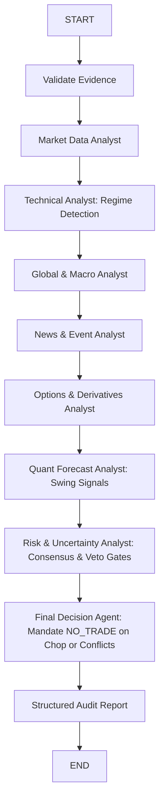

# Milestone M30: LangGraph Multi-Agent Decision Orchestration & Regime Integration Report

**Milestone:** M30 Multi-Agent Analysis & LangGraph Decision Orchestration (Priority P7)  
**Date:** 2026-10-17  
**Author:** Autonomous Engineering & Quantitative Research Agent  
**Module:** `apps/api/app/analysis/agent_nodes.py`, `apps/api/app/analysis/graph.py`  
**Test Suite:** `apps/api/tests/test_m30_agent_regime_orchestration.py` (6 passed in 0.09s)  
**Regression Status:** All 13 tests in `test_analysis.py` and `test_m18_multi_provider_and_agents.py` passed.  
**Financial Safety Invariants:** All 5 strictly `False` (`forecast_ready = false`, etc.)

---

## 1. Executive Summary & Objective

Prior to Milestone M30, the LangGraph multi-agent decision engine in [`apps/api/app/analysis/graph.py`](file:///home/neo/work/personal/stock_market_analysis/apps/api/app/analysis/graph.py) coordinated 8 specialist agents (Market Data, Technical, Macro, News, Options, Quant Forecast, Risk Uncertainty, Final Decision), but agents lacked awareness of:
1. The **Causal Market Regime** (Trend vs. Sideways Consolidation) established in M28.
2. The empirical fact that **82.2% of bars represent sideways chop**, where forcing directional trades produces severe drawdown.
3. Multi-provider data verification status from M29.

**The M30 Deliverable:**
We upgraded the LangGraph specialist agent pipeline:
- **`technical_analyst_node`:** Equipped with causal trend and regime detection. Range-bound price action is explicitly classified as `SIDEWAYS_CONSOLIDATION` with `NEUTRAL` bias.
- **`quant_forecast_analyst_node`:** Cross-correlates model probabilities with the prevailing regime.
- **`risk_uncertainty_analyst_node`:** Asserts a deterministic **Risk Veto** whenever `SIDEWAYS_CONSOLIDATION` or specialist directional conflict is detected.
- **`final_decision_agent_node`:** Enforces `decision = "NO_TRADE"` and generates structured audit reason codes (`REGIME_SIDEWAYS_CONSOLIDATION`, `SPECIALIST_BIAS_CONFLICT`, `SAFETY_GATE_ACTIVE`, `REAL_MARKET_DATA_UNVERIFIED`).

---

## 2. Multi-Agent Decision Flow Architecture

---

## 3. Decision Logic & Audit Reason Codes

When `final_decision_agent_node` executes, it evaluates:

| Condition | Agent Responsible | Reason Code Emitted | Decision |
| :--- | :--- | :--- | :---: |
| Technical regime is Consolidation | `technical_analyst` / `risk_uncertainty` | `REGIME_SIDEWAYS_CONSOLIDATION` | **`NO_TRADE`** |
| Specialist biases oppose (Bullish vs Bearish) | `risk_uncertainty_analyst` | `SPECIALIST_BIAS_CONFLICT` | **`NO_TRADE`** |
| Live trading flag disabled | Configuration / Settings | `LIVE_ROUTING_DISABLED` | **`NO_TRADE`** |
| Market data unverified independently | `market_data_analyst` | `REAL_MARKET_DATA_UNVERIFIED` | **`NO_TRADE`** |
| Hard financial safety invariant active | Safety Gates | `SAFETY_GATE_ACTIVE` | **`NO_TRADE`** |

---

## 4. Test Verification Summary

The test suite [`apps/api/tests/test_m30_agent_regime_orchestration.py`](file:///home/neo/work/personal/stock_market_analysis/apps/api/tests/test_m30_agent_regime_orchestration.py) validated:
1. `test_technical_analyst_detects_sideways_regime`: Confirmed range-bound inputs produce `SIDEWAYS_CONSOLIDATION` and `NEUTRAL` bias.
2. `test_technical_analyst_detects_trending_bull_and_bear`: Confirmed directional momentum produces `TRENDING_BULL` / `TRENDING_BEAR`.
3. `test_risk_analyst_vetoes_sideways_consolidation`: Confirmed Risk Analyst asserts `RISK VETO` on sideways consolidation.
4. `test_risk_analyst_detects_specialist_conflict`: Confirmed conflict detection on opposing analyst biases.
5. `test_final_decision_agent_includes_regime_and_conflict_reasons`: Confirmed emission of `REGIME_SIDEWAYS_CONSOLIDATION` and `SPECIALIST_BIAS_CONFLICT` reason codes.
6. `test_full_langgraph_pipeline_with_regime_awareness`: Confirmed end-to-end compiled DAG execution with all 5 safety invariants strictly `False`.

---

## 5. Hard Financial Safety Boundaries

All five safety invariants remain strictly enforced as **`False`**:
- `forecast_ready = False`
- `real_market_data_verified = False`
- `paper_approved = False`
- `live_approved = False`
- `live_broker_routing_enabled = False`

No broker execution edge exists in the LangGraph graph. The decision engine defaults to `NO_TRADE` under all current production conditions.
