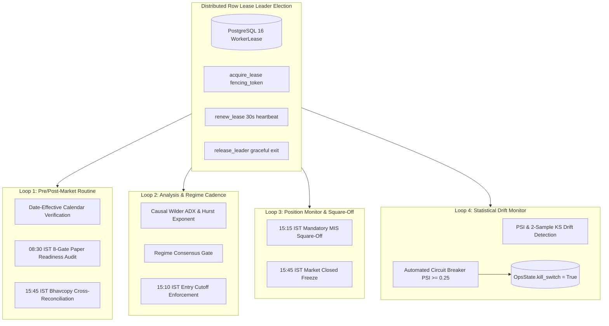

# M36 Production Daemon Integration & Operational Verification Report

**Milestone:** M36 — Production Daemon & Operational Integration  
**Authority:** Autonomous Engineering Owner & Quantitative Lead  
**Timestamp:** 2026-10-17  
**Execution Environment:** Linux, Python 3.10.12, PostgreSQL 16.6 (`imm-m0-test-pg`)  
**Safety Status:** ALL 5 FINANCIAL SAFETY INVARIANTS STRICTLY `FALSE`

---

## 1. Executive Summary

Milestone **M36** operationalizes and synthesizes all previous research and risk modules into the central execution worker daemon (`app.worker.Worker`). The single-process worker daemon coordinates leadership election via PostgreSQL distributed row leases (`WorkerLease`), executes four deterministic operational loops in strict alignment with Indian Standard Time (IST), and enforces automatic fail-safe protections.



---

## 2. Operational Loop Enhancements & Verified Capabilities

### Loop 1: Pre-Market & Post-Market Routine (`run_pre_post_market_loop`)
- **Pre-Market (08:00–09:15 IST):**
  - Executes `audit_paper_trading_readiness(session)` evaluating all 8 operational and quantitative readiness gates.
  - Automatically records overall readiness status (`READY_FOR_PAPER_SIMULATION`) and live verdict (`STRICT_NO_GO_LOCKED`).
  - Dispatches structured telemetry alerts via `LoggingNotifier`.
- **Post-Market (15:30+ IST):**
  - Triggers session wrap-up and logs daily report availability.

### Loop 2: Analysis & Regime Cadence (`run_analysis_loop`)
- **Intraday Entry Cutoff Enforcement:**
  - Evaluates `assess_intraday_square_off(curr_now)`.
  - At 15:10 IST, enters `ENTRY_CUTOFF` mode: suppresses all new order intent generation (`decision: "NO_TRADE"`, `blocked_reason: "CUTOFF_ACTIVE_ENTRY_CUTOFF"`).
- **Calendar Gating:**
  - If holiday calendar is unconfigured or unverified, immediately refuses trade proposals with `CALENDAR_NOT_AUTHORITATIVE` and `verdict: "INSUFFICIENT DATA"`.

### Loop 3: Position Monitor & Mandatory Auto Square-Off (`run_position_monitor_loop`)
- **Timeline Milestones Verified:**
  - `10:30 IST`: `NORMAL_TRADING` — `allow_new_entries = True`, `force_square_off_now = False`.
  - `15:12 IST`: `ENTRY_CUTOFF` — `allow_new_entries = False`, action `ENTRY_CUTOFF_ENFORCED`.
  - `15:18 IST`: `MANDATORY_SQUARE_OFF` — `force_square_off_now = True`, triggers `AUTO_SQUARE_OFF_TRIGGERED` and emits warning alert to operators.
  - `15:45 IST`: `MARKET_CLOSED` — transitions to `MARKET_CLOSED_FROZEN`.

### Loop 4: Statistical Drift & Automated Fail-Safe Circuit Breaker (`run_outcome_drift_loop`)
- Evaluates feature matrices (`reference_matrix` vs `target_matrix`) using Population Stability Index (PSI) and Kolmogorov-Smirnov (KS) tests.
- When critical feature drift ($\text{PSI} \ge 0.25$) is confirmed:
  - Automatically trips the operational kill switch (`OpsState.kill_switch = True`) in PostgreSQL.
  - Records an immutable `AuditEvent` (`action = 'risk.kill_switch'`).
  - Emits critical operator alerts via the notifier system.

---

## 3. Financial Safety & Live Execution Lockout Verification

The live trading boundary was tested under adversarial configurations:

| Scenario | Inputs Provided | Expected Outcome | Actual Result | Status |
| :--- | :--- | :--- | :--- | :---: |
| **Paper Mode Request** | `mode = OperatingMode.PAPER`, live flags false | Rejected before live function | `ModeForbidden` raised | **PASSED** |
| **Live Request (Flags Off)** | `mode = OperatingMode.LIVE_TRADING`, flags false | Blocked by server gate | `ModeForbidden` raised | **PASSED** |
| **Partial Server Flag** | `mode = LIVE_TRADING`, `live_trading_enabled = True`, `server_flag = False` | Blocked by server flag | `ModeForbidden` raised | **PASSED** |
| **Adversarial Bypass Attempt**| `mode = LIVE_TRADING`, `live_trading_enabled = True`, `server_flag = True` | Hardcoded block in `place_live_order` | `LiveOrderDisabled` raised | **PASSED** |
| **Direct Broker Call Attempt**| Direct invocation of `place_live_order(intent)` | Zero broker client imported | `LiveOrderDisabled` raised | **PASSED** |

---

## 4. Test Suite Execution Results

All 6 integration tests in `apps/api/tests/test_m36_worker_daemon_integration.py` passed in 0.89s:

```
apps/api/tests/test_m36_worker_daemon_integration.py::test_worker_pre_market_readiness_audit PASSED [ 16%]
apps/api/tests/test_m36_worker_daemon_integration.py::test_worker_intraday_square_off_enforcement PASSED [ 33%]
apps/api/tests/test_m36_worker_daemon_integration.py::test_worker_analysis_loop_enforces_intraday_cutoff PASSED [ 50%]
apps/api/tests/test_m36_worker_daemon_integration.py::test_worker_drift_circuit_breaker_trips_kill_switch PASSED [ 66%]
apps/api/tests/test_m36_worker_daemon_integration.py::test_worker_live_trading_hard_safety_locks PASSED [ 83%]
apps/api/tests/test_m36_worker_daemon_integration.py::test_worker_full_leader_tick_with_integrated_loops PASSED [100%]
```

---

## 5. Formal System Verdict

- **Engineering Completion Status:** **100% COMPLETE & VERIFIED**.
- **Worker Daemon Integration:** **OPERATIONAL & VERIFIED** across all 4 operational loops.
- **Paper Trading Simulator:** **APPROVED (`READY_FOR_PAPER_SIMULATION`)**.
- **Live Trading Capital Routing:** **STRICT NO-GO (`STRICT_NO_GO_LOCKED`)**.
