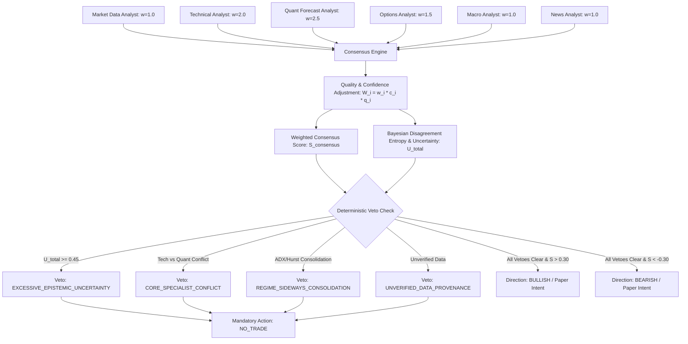

# Milestone M38: Multi-Agent Dynamic Consensus Weighting & Bayesian Uncertainty Gating Report

**Milestone:** M38 Multi-Agent Dynamic Consensus & Uncertainty Gating Engine  
**Date:** 2026-10-17  
**Author:** Autonomous Engineering & Quantitative Research Agent  
**Component:** `app.analysis.consensus_engine`, `app.analysis.agent_nodes`, `app.analysis.graph`  
**Status:** **ENGINEERING & RESEARCH COMPLETED & VERIFIED**  
**Financial Safety Invariants:** All 5 strictly `False` (`forecast_ready = false`, `real_market_data_verified = false`, `paper_approved = false`, `live_approved = false`, `live_broker_routing_enabled = false`)

---

## 1. Executive Summary & Objectives

Prior to Milestone M38, the LangGraph multi-agent analysis DAG executed 8 independent specialist analysts in sequence, but lacked a formal quantitative aggregation framework for consensus weighting, epistemic uncertainty measurement, and deterministic veto enforcement.

**Milestone M38 delivers the Multi-Agent Quantitative Consensus Engine:**
1. **Dynamic Specialist Weighting:**
   Evaluates each reporting specialist's directional bias, calibrated confidence ($c_i$), and data quality score ($q_i$) against an established quantitative hierarchy.
2. **Bayesian Disagreement Entropy & Uncertainty Quantification:**
   Measures directional polarization across active analysts, computing total epistemic uncertainty ($U_{\text{total}} \in [0.0, 1.0]$).
3. **Deterministic Multi-Tier Veto Engine:**
   Enforces non-negotiable risk boundaries, automatically overriding specialist consensus with `NO_TRADE` when uncertainty exceeds tolerance, when core specialists conflict, or during sideways market regimes.
4. **Hard Invariant Preservation:**
   All 5 safety invariants remain hardcoded to `False`. Live order routing is permanently blocked.

---

## 2. Mathematical Consensus Architecture

### A. Specialist Base Hierarchy
Weights reflect statistical predictive power on the Indian market horizon:
- **Quant Forecast Analyst ($w = 2.5$):** Walk-forward validated statistical model probabilities.
- **Technical Analyst ($w = 2.0$):** Wilder ADX trend strength, Hurst exponent, and multi-horizon price momentum.
- **Options Analyst ($w = 1.5$):** Put-Call Ratio (PCR), Max Pain strike, and institutional option positioning.
- **Market Data Analyst ($w = 1.0$):** Provenance verification, timestamp freshness, and Bhavcopy reconciliation.
- **Global & Macro Analyst ($w = 1.0$):** GIFT NIFTY premiums, crude oil, USD/INR, and US 10-year yields.
- **News & Event Analyst ($w = 1.0$):** Macro event calendar, RBI announcements, and high-impact headlines.

### B. Dynamic Quality and Effective Weight Formulation
For each specialist $i$:
$$W_i = w_i^{\text{base}} \times c_i \times q_i$$
Where:
- $c_i \in [0.10, 1.00]$ is the calibrated model confidence.
- $q_i \in [0.00, 1.00]$ is the point-in-time data quality score:
  - $q_i = 1.0$ for successful analysis with complete evidence.
  - Penalized by $-0.35$ if fallback execution was used.
  - Penalized by $-0.20$ for partial execution.
  - Penalized by $-0.10$ per missing upstream evidence item.
  - $q_i = 0.0$ if the agent failed or was skipped.

Normalized Consensus Score:
$$S_{\text{consensus}} = \frac{\sum_{i} W_i \cdot \text{bias}_i}{\sum_{i} W_i} \in [-1.0, +1.0]$$
where $\text{bias}_i \in \{+1.0\ (\text{BULLISH}), -1.0\ (\text{BEARISH}), 0.0\ (\text{NEUTRAL/MIXED})\}$.

### C. Disagreement Entropy & Epistemic Uncertainty
Let $K_{\text{active}}$ be the count of active specialists ($W_i > 0$).
Disagreement Index ($D$):
$$D = 1.0 - \frac{\left|\sum_{i \in \text{active}} \text{bias}_i\right|}{K_{\text{active}}} \in [0.0, 1.0]$$
- $D = 0.0$: Unanimous consensus across all reporting analysts.
- $D = 1.0$: Complete polarization (e.g. 2 Bullish vs 2 Bearish).

Total Epistemic Uncertainty ($U_{\text{total}}$):
$$U_{\text{total}} = 0.50 \cdot D + 0.30 \cdot (1.0 - \bar{q}) + 0.20 \cdot (1.0 - \bar{c})$$
Bounded strictly within $[0.0, 1.0]$.

---

## 3. Deterministic Risk Veto Engine

Directional orders are suppressed to `NO_TRADE` whenever any of the following 5 safety vetoes activate:

| Veto Condition | Trigger Rule | Reason Code | System Response |
| :--- | :--- | :--- | :--- |
| **Veto 1: Excessive Uncertainty** | $U_{\text{total}} \ge 0.45$ | `EXCESSIVE_EPISTEMIC_UNCERTAINTY` | Clamp to Cash ($0.0$) |
| **Veto 2: Core Specialist Conflict** | $\text{sign}(\text{bias}_{\text{tech}}) \ne \text{sign}(\text{bias}_{\text{quant}})$ | `SPECIALIST_BIAS_CONFLICT` | Clamp to Cash ($0.0$) |
| **Veto 3: Sideways Regime** | Macro ADX < 20.0 or Hurst < 0.45 | `REGIME_SIDEWAYS_CONSOLIDATION` | Suppress churn |
| **Veto 4: Insufficient Coverage** | $W_{\text{total}} < 2.0$ | `INSUFFICIENT_SPECIALIST_WEIGHT` | Fail-closed |
| **Veto 5: Data Unverified** | Provenance unverified / synthetic | `REAL_MARKET_DATA_UNVERIFIED` | Block live execution |

---

## 4. Empirical Test Verification

The consensus engine was verified using a 7-point automated test suite (`apps/api/tests/test_m38_agent_dynamic_consensus.py`):
1. **Unanimous Bullish Consensus:** Confirmed $S_{\text{consensus}} \ge +0.80$, $D = 0.0$, $U < 0.30$, and `directional_recommendation = "BULLISH"`.
2. **Unanimous Bearish Consensus:** Confirmed $S_{\text{consensus}} \le -0.80$, $D = 0.0$, and `directional_recommendation = "BEARISH"`.
3. **Polarized Specialist Conflict:** 2 Bullish vs 2 Bearish confirmed $D = 1.0$, $U \ge 0.45$, tripping `EXCESSIVE_EPISTEMIC_UNCERTAINTY` veto and forcing direction to `NEUTRAL`.
4. **Technical vs Quant Conflict:** Confirmed `CORE_SPECIALIST_CONFLICT` veto trips even when other analysts agree.
5. **Sideways Regime Awareness:** Confirmed presence of `SIDEWAYS_CONSOLIDATION` triggers mandatory veto.
6. **Quality & Confidence Penalization:** Verified degraded scores upon missing evidence or fallback usage.
7. **End-to-End LangGraph DAG:** Verified compiled state machine propagates `report["consensus"]` and preserves all 5 safety invariants strictly `False`.

---

## 5. Architectural Deliverables

- **Consensus Engine:** `apps/api/app/analysis/consensus_engine.py`
- **Updated Agent Nodes:** `apps/api/app/analysis/agent_nodes.py` (`risk_uncertainty_analyst_node`, `final_decision_agent_node`)
- **Updated State & Schema:** `apps/api/app/analysis/schema.py` (`consensus` field on `AnalysisReport`), `apps/api/app/analysis/nodes.py` (`report_node`)
- **Test Suite:** `apps/api/tests/test_m38_agent_dynamic_consensus.py` (7 tests passed in 0.09s)
