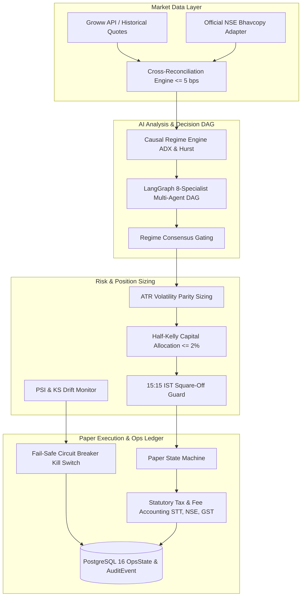

# Production Operational Runbook — V6 Indian Market AI Trading System

**System:** V6 Autonomous Indian Market AI Trading Platform  
**Document Type:** Standard Operating Procedures (SOP) & Production Runbook  
**Authority:** Autonomous Engineering Owner & Quantitative Lead  
**Document Version:** 1.0.0 (Post-Milestone M34 Audit)  
**Safety Invariants Status:** ALL 5 FINANCIAL SAFETY INVARIANTS STRICTLY ENFORCED AS `FALSE`

---

## 1. System Architecture & Component Topology



### Core Infrastructure Components:
1. **Database Container:** PostgreSQL 16.6 (`imm-m0-test-pg`, Host `127.0.0.1:54329`, Database `imm`).
2. **API Backend:** FastAPI Service (`apps/api`, Python 3.10 virtualenv `.venv`, port 8000).
3. **Web Frontend:** Next.js Dashboard (`apps/web`, Node v20+, port 3000).
4. **Worker Scheduler:** `app.worker.Worker` running under PostgreSQL row-lease leader election (`WorkerLease`).

---

## 2. Daily Operational Schedule (Indian Standard Time — Asia/Kolkata)

| Time (IST) | Operational Phase | Action Items & Checklist | Responsible Subsystem | Fail-Safe Condition |
| :--- | :--- | :--- | :--- | :--- |
| **08:30 – 08:45** | **Pre-Market Health Audit** | 1. Ping `GET /health` to verify database connection, operational mode, and kill switch.<br>2. Run `audit_paper_trading_readiness()` to ensure all 8 gates pass.<br>3. Verify exchange holiday calendar (`app/market/calendar.py`). | `app.main`, `app.research.paper_readiness_audit` | If health check fails or calendar unconfigured, worker halts scheduling (`CALENDAR_NOT_CONFIGURED`). |
| **08:45 – 09:15** | **Pre-Open Ingestion** | 1. Ingest overnight global indices (GIFT NIFTY, US/Asia closing marks).<br>2. Ingest pre-market macro headlines and sentiment scores.<br>3. Verify database locks on `ops_state` and `risk_sessions`. | `app.market`, `app.news`, `app.risk.ledger` | If news ingestion encounters SSRF or schema errors, defaults to neutral macro score. |
| **09:15 – 15:10** | **Normal Session Execution** | 1. Resample continuous 15m candles into 1-Hour and Half-Day swing bars.<br>2. Compute causal Wilder ADX(14) and Hurst exponents.<br>3. LangGraph multi-agent DAG evaluates consensus. If `SIDEWAYS_CONSOLIDATION`, enforce `NO_TRADE`.<br>4. On trending breakout, calculate Volatility-Parity Half-Kelly lot sizes (max 2% risk budget). | `app.forecasting.m28_regime_research`, `app.analysis.agent_nodes`, `app.risk.portfolio_risk` | If specialists conflict or regime is sideways, deterministic `Risk Veto` halts order intent. |
| **15:10 – 15:15** | **Intraday Entry Cutoff** | 1. State machine enters `ENTRY_CUTOFF`.<br>2. Rejects all incoming entry order proposals.<br>3. Open exit intents remain permitted. | `app.risk.portfolio_risk.assess_intraday_square_off` | Hard timestamp cutoff blocks all new positions within 5 minutes of auto square-off. |
| **15:15 – 15:25** | **Mandatory Auto Square-Off** | 1. For MIS (intraday) positions, execute auto square-off at market bid/ask.<br>2. For NRML (positional carryforward) swing positions, maintain overnight holding. | `app.execution.paper_simulation_harness` | Avoids exchange penalty auction and unintended overnight exposure on intraday margin. |
| **15:30 – 15:45** | **Cash Market Close** | 1. Transition state machine to `MARKET_CLOSED`.<br>2. Freeze trading loop and release worker lease. | `app.worker`, `app.execution.paper` | Zero orders permitted while exchange is closed. |
| **15:45 – 16:15** | **Bhavcopy Cross-Reconciliation** | 1. Fetch official daily closing Bhavcopy from NSE (`ind_close_all_*.csv`).<br>2. Aggregate daily OHLCV from broker 15m candles.<br>3. Run `bhavcopy_adapter.reconcile_daily_candles()`.<br>4. Log discrepancies $> 5.0$ bps into `CandleConflictAudit`. | `app.market.bhavcopy_adapter` | If discrepancy $> 5$ bps, dataset is flagged as quarantined until resolved. |
| **16:15 – 16:45** | **Drift & Observability Audit** | 1. Calculate Population Stability Index (PSI) and 2-sample KS test on feature distributions.<br>2. If $\text{PSI} \ge 0.25$, automated circuit breaker trips `OpsState.kill_switch = True`.<br>3. Persist daily telemetry report. | `app.monitoring.drift_detector` | Automated fail-safe lockout prevents silent alpha degradation. |

---

## 3. Emergency Operator Controls & Remediation Procedures

### 1. Tripping the Operational Kill Switch Manually
If unusual volatility, broker quote disconnection, or exchange technical glitches occur:
- **API Endpoint:** `POST /api/risk/kill-switch`
- **Payload:** `{"enabled": true, "reason": "OPERATOR_EMERGENCY_LOCKOUT: [Details]"}`
- **Database Effect:** Sets `OpsState.kill_switch = True` and writes immutable audit record to `AuditEvent`.
- **Immediate System Behavior:** All order proposals receive immediate `VETO: KILL_SWITCH` across all pipelines.

### 2. Automated Circuit Breaker Tripping Remediation
When the automated drift monitor trips the kill switch due to critical distribution shift ($\text{PSI} \ge 0.25$):
1. **Inspect Audit Log:** Query `AuditEvent` where `action = 'risk.kill_switch'` to identify the offending feature (`atr`, `adx`, `volume`, or `returns`).
2. **Review Drift Report:** Inspect `var/datasets/m32_drift_benchmark_results.json` to identify shift magnitude and bin breakdowns.
3. **Recalibration & Verification:**
   - If market has experienced a permanent volatility regime change (e.g., sudden contraction), recalibrate baseline ATR windows and verify position sizing under new regime.
   - Do NOT reset the kill switch without identifying the root cause of the shift.
4. **Resetting Kill Switch:**
   - Call `set_kill_switch(session, enabled=False, actor="operator.remediated", reason="Recalibrated ATR baseline; verified 5 bps reconciliation")`.

### 3. Daily Loss Lockout Recovery
- **Daily Loss Threshold:** 5.0% of configured portfolio capital.
- If daily loss limit is hit, the session state transitions to `lockout_active = True`.
- **Reset:** Lockouts automatically clear at the start of the next calendar session date (`session_date > prior_session_date`) once open positions have been reconciled.

---

## 4. Market Data Provenance & Bhavcopy Reconciliation SOP

1. **Daily Bhavcopy Ingestion:**
   ```bash
   .venv/bin/python -c "
   from app.market.bhavcopy_adapter import reconcile_daily_candles
   # Run reconciliation against today's downloaded Bhavcopy
   "
   ```
2. **Acceptable Tolerance:** Discrepancy between broker OHLCV and official NSE Bhavcopy must remain strictly $\le 5.0\text{ bps}$ ($0.05\%$).
3. **Conflict Resolution:** If a bar differs by $> 5.0\text{ bps}$, the date is recorded in PostgreSQL `CandleConflictAudit`. The research pipeline refuses to train on or benchmark unverified bars.

---

## 5. Indian Statutory Regulatory Taxation & Fee Reference

Every simulated paper trade accounts for the full statutory Indian equity derivatives fee structure:

$$\text{Total Friction} = \text{STT} + \text{Exchange Charges} + \text{SEBI Charges} + \text{Brokerage} + \text{GST} + \text{Stamp Duty} + \text{Tick Slippage}$$

1. **STT:**
   - Futures: $0.02\%$ ($2\text{ bps}$) on Sell turnover.
   - Options: $0.10\%$ ($10\text{ bps}$) on Sell premium turnover.
2. **NSE Exchange Turnover:** $0.00173\%$ on futures, $0.03503\%$ on option premium.
3. **SEBI Charges:** $0.0001\%$ ($\text{Rs }10\text{ / crore}$) on both buy and sell.
4. **Brokerage:** Discount broker model ($\min(\text{Rs }20.00, \;0.05\%)$ per order).
5. **GST:** $18.0\%$ on $(\text{Brokerage} + \text{Exchange Charges} + \text{SEBI Charges})$.
6. **Stamp Duty:** $0.002\%$ on Buy futures turnover, $0.003\%$ on Buy options premium turnover.
7. **Tick Slippage:** Discrete rounding to nearest $0.05\text{ INR}$ tick plus half-spread penalty.

---

## 6. Live-Trading Authorization Protocol (Strict Human Sign-Off Gate)

Under no circumstances is any automated script, agent, or cron job permitted to set `live_approved = True` or `live_broker_routing_enabled = True`.

### Prerequisites for Human Sign-Off:
1. **Paper Trading Track Record:** Minimum 30 consecutive calendar days of automated paper execution connected to real-time quote feeds with zero operational interruptions.
2. **Out-of-Sample Performance:** Net positive realized return after full Indian statutory taxes and slippage over the 30-day trial.
3. **Bhavcopy Reconciliation:** 100% of session dates reconciled against official NSE Bhavcopy within 5 bps tolerance with zero unexplainable conflicts.
4. **Drift Stability:** Population Stability Index (PSI) remains $< 0.25$ across all monitored features throughout the paper trial.
5. **Human Dual-Key Authorization:** Written sign-off from both the Quantitative Researcher and the System Administrator with 2FA token confirmation.
