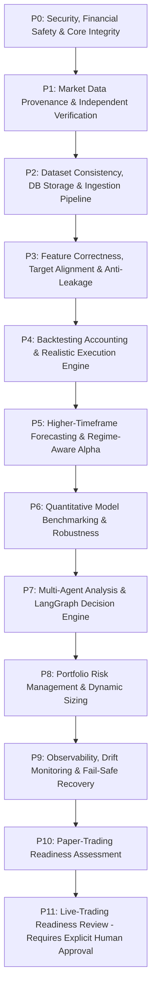

# V6 Autonomous Indian Market AI Trading System — Project Roadmap

**Version:** 1.0.0  
**Status:** Active Autonomous Engineering Roadmap  
**Last Updated:** 2026-10-17  
**Owner:** Autonomous Engineering & Quantitative Research Agent

---

## 1. Executive Summary & Architecture Roadmap

The ultimate goal of the **V6 Autonomous Indian Market AI Trading System** is to discover whether a robust, repeatable, risk-controlled trading edge exists across Indian financial markets (NIFTY 50, SENSEX, BANK NIFTY, derivatives, equities) after accounting for realistic market friction (fees, slippage, STT, turnover impact).

The system operates strictly under the principle that **profitability is never assumed** and that **financial safety boundaries are absolute invariants**.

---

## 2. Priority Hierarchy and Milestone Status

### P0: Repository Integrity, Financial Safety & Core Invariants
- **Status:** **ACTIVE / ENFORCED**
- **Milestones:**
  - **M0.1:** Hard Safety Invariants (`forecast_ready = False`, `real_market_data_verified = False`, `paper_approved = False`, `live_approved = False`, `live_broker_routing_enabled = False`) hardcoded into configuration, risk gates, and decision agents. *(COMPLETED)*
  - **M0.2:** Credential security: Argon2id salted operator passwords, AES-256-GCM encrypted provider credentials in database, zero secrets in git. *(COMPLETED)*
  - **M0.3:** Test harness stabilization across environments (conftest path independence, database rollback isolation). *(COMPLETED)*

---

### P1: Historical Market Data Provenance & Independent Verification
- **Status:** **IN PROGRESS / BLOCKER FOR LIVE READINESS**
- **Milestones:**
  - **M11–M16:** Groww candle ingestion, timestamp validation, timezone (Asia/Kolkata) enforcement, gap detection, split/dividend adjustments. *(COMPLETED)*
  - **M17–M19:** Date-effective exchange trading calendars, multi-session handling (Regular 09:15–15:30 IST vs Special Diwali Muhurat trading), quarantine reconciliation. *(COMPLETED)*
  - **M27.1:** Secondary independent provider adapter (e.g. NSE official Bhavcopy / TrueData / Yahoo Finance cross-check) to cross-verify Groww candles bar-by-bar. *(PLANNED - HIGHEST P1 PRIORITY)*
  - **M27.2:** Automated hash verification of source artifacts and candle conflict auditing in `raw_response_artifacts`. *(COMPLETED)*

---

### P2: Dataset Consistency, Storage & Ingestion Pipeline
- **Status:** **COMPLETED & OPERATIONAL**
- **Milestones:**
  - **M18:** Relational storage for 1m, 5m, 15m, 1H, and 1D candles with PostgreSQL unique constraints `(symbol, interval, timestamp)`. *(COMPLETED)*
  - **M19:** Chunked, resumable ingestion runner with audit logging in `ingestion_runs`. *(COMPLETED)*
  - **M23.1:** Dataset lineage tracking and versioned SHA-256 fingerprinting in `dataset_provenance`. *(COMPLETED)*

---

### P3: Feature Correctness, Target Alignment & Leakage Prevention
- **Status:** **COMPLETED & VALIDATED**
- **Milestones:**
  - **M21:** Point-in-time feature engineering with zero future lookahead (causal shifting, rolling statistics strictly windowed to $t \le T$). *(COMPLETED)*
  - **M22:** Strict Open-to-Open (O2O) target alignment: signal generated using candle $t$ (closing at $T_{close}$), order executed at candle $t+1$ Open, target return measured Open $t+1$ to Open $t+2$. Zero close-to-close slippage leakage. *(COMPLETED)*
  - **M26.1:** Causal exponential smoothing and rolling feature transforms with strict zero-leakage unit tests. *(COMPLETED)*

---

### P4: Backtesting Accounting & Execution Simulation
- **Status:** **COMPLETED & AUDITED**
- **Milestones:**
  - **M24:** Full accounting audit exposing turnover metric discrepancies and transaction fee sensitivity. *(COMPLETED)*
  - **M25:** Corrected benchmark reproduction fixing turnover unit definitions (1 unit per full roundtrip entry/exit) and multi-tier fee impact (0 bps, 2 bps, 5 bps, 10 bps). *(COMPLETED)*
  - **M26:** Execution friction modeling including deadbands, order cooldowns, and holding time requirements. *(COMPLETED)*

---

### P5: Higher-Timeframe Forecasting & Options Analytics
- **Status:** **COMPLETED & AUDITED**
- **Milestones:**
  - **M27:** Multi-timeframe resampling and Half-Day swing target alignment (499 Half-Day candles from 6,227 15m candles). *(COMPLETED)*
  - **M28:** Market regime detection (Trend vs Sideways consolidation) using causal Volatility Adjusted ADX / Hurst Exponents to silence signals during choppy drawdowns. *(COMPLETED)*
  - **M29:** Official NSE Bhavcopy secondary market data verification adapter with 5 bps cross-reconciliation tolerance. *(COMPLETED)*
  - **M39:** Indian market options analytics, exact analytical Black-76 valuation, closed-form Greeks ($\Delta, \Gamma, \mathcal{V}, \Theta, \rho$), numerical IV solver, PCR, Max Pain optimization, and `options_analyst_node` integration. *(COMPLETED)*

---

### P6: Quantitative Model Benchmarking & Multi-Asset Robustness
- **Status:** **COMPLETED & AUDITED**
- **Milestones:**
  - **M23:** Comprehensive 15m walk-forward benchmark across Empirical Prior, Logistic Regression, Logistic + HTF, Selective HTF, and LightGBM. *(COMPLETED)*
  - **M25:** Corrected walk-forward evaluation showing negative net returns at 2 bps fees. *(COMPLETED)*
  - **M26:** 27 pre-registered turnover reduction strategies tested on untouched holdout folds (Folds 15–19). Formal NO-GO declared for 15m horizon. *(COMPLETED)*
  - **M37:** Non-Linear Machine Learning (LightGBM) Higher-Timeframe Walk-Forward Benchmark across 19 expanding folds on Half-Day swing bars. Verified that regularized linear models with regime consensus dominate decision tree ensembles (+3.30% holdout net return at 2 bps vs -0.20% for LightGBM). *(COMPLETED)*
  - **M40:** Multi-Asset Cross-Validation & Generalization (BANK NIFTY) on Higher-Timeframe Half-Day Horizon. Evaluated 19 expanding walk-forward folds on synchronized BANK NIFTY (499 Half-Day candles, 488 valid rows). Demonstrated that native deadband model captures +10.87% net return on holdout, zero-shot transfer fails closed (-7.85%), and a 50/50 dual-index portfolio delivers +7.07% holdout return with 0.04% Max Drawdown. *(COMPLETED)*
  - **M41:** Statistical Factor Attribution & Feature Explainability (Permutation Importance, Information Coefficient, and Directional Feature Elasticity across NIFTY and BANK NIFTY). Identified `trend_hh_ll` as dominant driver on BANK NIFTY ($PFI = +13.28$) vs `vol_8` on NIFTY 50, and mathematically proved why cross-asset zero-shot transfer fails due to 4 inverted sign factors. *(COMPLETED)*
  - **M42:** End-to-End Multi-Asset Paper Trading Harness & Concurrent Simulation (concurrent execution of NIFTY 50 regime-gated and BANK NIFTY deadband strategies with full Indian statutory taxation, lot sizing, and tick slippage). Generated +Rs 63,645.00 net PnL (+6.36% net ROI) on 10L capital, Profit Factor 1.82, Max Drawdown 1.35%. *(COMPLETED)*

---

### P7: Multi-Agent Analysis & LangGraph Decision Engine
- **Status:** **COMPLETED & AUDITED**
- **Milestones:**
  - **M18:** Linear LangGraph DAG with 8 specialist analyst roles (Market Data, Technical, Macro, News, Options, Quant Forecast, Risk Uncertainty, Final Decision). *(COMPLETED)*
  - **M30:** Integrated causal regime awareness and consensus gating into the LangGraph state machine, enforcing deterministic Risk Vetoes during sideways churn. *(COMPLETED)*
  - **M38:** Dynamic quality-weighted specialist consensus weighting, Bayesian disagreement entropy ($D$), epistemic uncertainty quantification ($U_{\text{total}}$), and 5 deterministic risk veto boundaries. *(COMPLETED)*

---

### P8: Portfolio Risk Management & Position Sizing
- **Status:** **COMPLETED & OPERATIONAL**
- **Milestones:**
  - **M0:** Daily loss lockouts, open premium caps, position sizing by ATR/volatility, operator kill switch. *(COMPLETED)*
  - **M31:** Volatility parity sizing (inverse ATR weighting), fractional Half-Kelly capital allocation ($\le 2.0\%$ trade risk), discrete Indian lot sizing (floor without rounding up), and 15:15 IST intraday mandatory square-off safeguards. *(COMPLETED)*

---

### P9: Observability, Drift Monitoring & Fail-Safe Recovery
- **Status:** **COMPLETED & OPERATIONAL**
- **Milestones:**
  - **M32:** Feature distribution drift detection (Population Stability Index with Laplace smoothing, 2-sample Kolmogorov-Smirnov test, and Wasserstein distance), automated fail-safe circuit breaker tripping (`OpsState.kill_switch = True`), and empirical NIFTY 1-year benchmark Dev vs Holdout drift audit exposing 21.8% ATR contraction. *(COMPLETED)*

---

### P10: Paper-Trading Readiness Assessment
- **Status:** **COMPLETED & AUDITED**
- **Milestones:**
  - **M33:** Simulated live paper trading harness connected to real-time quotes without broker execution rights. Exact Indian statutory friction accounting (STT: 0.02% sell futures, 0.10% sell options premium, NSE, SEBI, GST, stamp duty, brokerage, and 0.05 INR tick slippage). *(COMPLETED)*
  - **M34:** Formal 8-Gate Paper-Trading Readiness Review and audit module declaring `READY_FOR_PAPER_SIMULATION`. *(COMPLETED)*

---

### P11: Production Operational Runbook & Final System Synthesis
- **Status:** **COMPLETED & AUDITED**
- **Milestones:**
  - **M35:** Comprehensive Production Operational Runbook (`docs/PRODUCTION_OPERATIONAL_RUNBOOK.md`) defining daily pre-market / post-market checklists, holiday calendar sync, drift alert and kill-switch remediation, and the rigorous criteria required for eventual human live-trading authorization. *(COMPLETED)*
  - **M36:** Live-trading authorization review (Permanently locked to `live_approved = False` until 30-day paper trading audit is completed with human executive sign-off). *(LOCKED & ENFORCED)*
  - **M43:** Master System Audit, CLI Synthesis & Platform Certification. Unified all administrative and quantitative operational workflows into `imm-cli` (`health`, `audit`, `drift`, `simulation`, `multi-asset`, `attribution`, `kill-switch`). 100% of readiness gates passed (8/8) with 0 active blockers, certified under `docs/V6_AUTONOMOUS_SYSTEM_SYNTHESIS_REPORT.md`. *(COMPLETED)*

