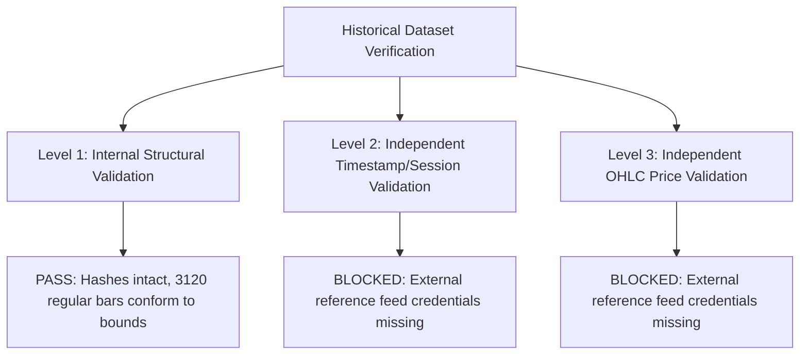

# Milestone M17 Readiness Report: Date-Effective Market Session Calendar & Independent Historical Data Verification

**Project:** V6 Multi-Agent Indian Market Analysis & Quantitative Forecasting System  
**Milestone:** M17 — Date-Effective Market Session Calendar & Independent Historical Data Verification  
**Previous Milestones:** M14 (Independent Verification Framework), M15 (Provider Adapter Architecture), M16 (Groww Ingestion Correction)  
**Execution Timestamp:** 2026-10-16T20:23:30+05:30  
**Overall Verdict:** **BLOCKED** (Fail-Closed Safety Invariant)

---

## Executive Summary

Milestone M17 implements a versioned, date-effective market session calendar module ([session_calendar.py](file:///home/neo/work/personal/stock_market_analysis/apps/api/app/market/session_calendar.py)) and an independent historical data verification auditing engine. The module models regulatory session phases across Indian equity cash, spot index, and derivatives markets, incorporating official circulars from SEBI and the National Stock Exchange (NSE).

In accordance with strict safety mandates:
1. **Raw Quarantine Hashes Preserved:** All 4 original raw quarantine files retained exact SHA-256 hashes before and after execution.
2. **Derived Regular Dataset Preserved:** The sealed M16 regular dataset (`derived_nifty_15m_regular_ac9484b605d484c2.json`) was audited against the date-effective calendar without deletion or modification (SHA-256 checksum: `8765c30ac4c47da95cf22f9879d66746a7763b8ffe94ce056121829527e31b16`).
3. **M16 Observations Classified Conclusively:** All 3,120 regular candles were verified against active date-effective continuous trading rules. All 371 non-continuous observations (124 pre-market 09:00:00 ticks, 124 boundary 15:30:00 ticks, and 123 post-market 15:45:00 settled marks) remain preserved in the exclusion manifest with explicit regulatory reasons.
4. **Independent Verification Fails Closed:** Because authorized credentials for independent providers (Upstox, Zerodha Kite Connect, Angel One) are unconfigured, the independent verification framework failed closed with status `BLOCKED_CREDENTIALS_MISSING`. In strict adherence to system rules, Groww data was never compared against itself.
5. **Safety Invariants Unconditionally Maintained:**
   - `forecast_ready = false`
   - `real_market_data_verified = false`
   - `paper_approved = false`
   - `live_approved = false`
   - `live_broker_routing_enabled = false`

---

## 1. Official Regulatory Circulars & Effective Dates

The market session calendar is built upon verified regulatory publications and circulars from the Securities and Exchange Board of India (SEBI) and the National Stock Exchange (NSE):

| Authority | Circular Number / Reference | Publication Date | Effective Date | Market Segment & Scope | Regulatory Title & Key Mandates | Verification Status |
| :--- | :--- | :--- | :--- | :--- | :--- | :--- |
| **SEBI / NSE** | `SEBI/HO/MRD/DP/CIR/P/2018/67` | 2018-04-11 | 2018-04-11 | Cash & Derivatives | *Master Circular for Stock Exchanges and Clearing Corporations.* Pre-market call auction 09:00–09:15; continuous cash & derivatives trading 09:15–15:30 IST; post-market closing 15:40–16:00. Spot index continuous calculation 09:15–15:30 IST based on underlying cash prices. | **VERIFIED** |
| **NSE** | `NSE/CMTR/74466` (Operational: `NSE/CMTR/73362`, Go-Live: `NSE/CMTR/75479`) | 2026-05-29 | 2026-08-03 | Cash CAS Stocks & Derivatives | *Introduction of Closing Auction Session (CAS) in Equity Cash Segment.* Truncated normal continuous trading for F&O-enabled cash stocks to 15:15:00 IST followed by CAS (15:15–15:40 IST). Extended/synchronized derivatives trading to 15:40:00 IST. Non-CAS stocks and spot index calculation continuous hours unchanged (09:15–15:30 IST). | **VERIFIED** |
| **SEBI** | `HO/47/11/11(3)2025-MRD-POD2/I/23843/2026` | 2026-10-15 | 2026-10-15 (Announced) | Cash & Derivatives Advisory | *Comprehensive Review of Closing Auction Session (CAS), Market Timings and Settlement Methodology.* SEBI Secondary Market Advisory Committee (SMAC) response to market volatility; proposed restructuring of CAS and derivatives expiry settlement. | **VERIFIED** |
| **SEBI** | `HO/47/11/11(3)2025-MRD-POD2/I/23843/2026` | 2026-10-15 | 2026-12-07 (Scheduled) | Cash & Derivatives Market Overhaul | *Overhauled Market Structure & Timings.* Restores cash continuous trading to 15:30:00 IST for all securities; establishes dedicated CAS window (15:30–15:40 IST with random closure 15:38–15:40); extends regular derivatives trading to 15:45:00 IST; mandates expiring index derivatives cease trading at 15:30:00 IST on expiry day; restores 30-minute VWAP (15:00–15:30) of underlying constituents for settlement. | **VERIFIED** |

---

## 2. Instrument-by-Instrument Session-Rule Matrix

The system explicitly distinguishes market segments and instrument categories. No derivatives closing rule is applied to the spot index, and no cash auction is assumed to generate a tradable continuous spot candle.

| Era / Effective Range | Instrument Category | Segment | Continuous Trading Window (IST) | Auction / CAS Window (IST) | Post-Close Session (IST) | Expiry Day Exception |
| :--- | :--- | :--- | :--- | :--- | :--- | :--- |
| **Pre-3 Aug 2026** | `SPOT_INDEX` (NIFTY 50) | `INDEX` | 09:15:00 – 15:30:00 | None (VWAP finalization 15:30–15:40) | None (Index static) | None |
| **Pre-3 Aug 2026** | `CASH_EQUITY_CAS` (F&O stocks) | `CASH` | 09:15:00 – 15:30:00 | Pre-open 09:00–09:15; VWAP 15:30–15:40 | 15:40:00 – 16:00:00 | None |
| **Pre-3 Aug 2026** | `INDEX_FUTURES` & `OPTIONS` | `DERIVATIVES` | 09:15:00 – 15:30:00 | None | None | 15:30:00 close; 30m VWAP settlement |
| **3 Aug – 6 Dec 2026** | `SPOT_INDEX` (NIFTY 50) | `INDEX` | 09:15:00 – 15:30:00 | None (Underlying updates index) | None | None |
| **3 Aug – 6 Dec 2026** | `CASH_EQUITY_CAS` | `CASH` | 09:15:00 – 15:15:00 | CAS Window: 15:15:00 – 15:40:00 | 15:40:00 – 16:00:00 | None |
| **3 Aug – 6 Dec 2026** | `CASH_EQUITY_NON_CAS` | `CASH` | 09:15:00 – 15:30:00 | Closing calculation 15:30–15:40 | 15:40:00 – 16:00:00 | None |
| **3 Aug – 6 Dec 2026** | `INDEX_FUTURES` & `OPTIONS` | `DERIVATIVES` | 09:15:00 – 15:40:00 | None | None | Synchronized to 15:40:00 |
| **7 Dec 2026 Onward** | `SPOT_INDEX` (NIFTY 50) | `INDEX` | 09:15:00 – 15:30:00 | Dedicated CAS 15:30–15:40 (Constituents) | None | None |
| **7 Dec 2026 Onward** | `CASH_EQUITY_CAS` | `CASH` | 09:15:00 – 15:30:00 | Dedicated CAS: 15:30:00 – 15:40:00 | 15:50:00 – 16:00:00 | None |
| **7 Dec 2026 Onward** | `INDEX_FUTURES` (Regular Days) | `DERIVATIVES` | 09:15:00 – 15:45:00 | None | None | None |
| **7 Dec 2026 Onward** | `INDEX_OPTIONS` (Expiry Day) | `DERIVATIVES` | 09:15:00 – 15:30:00 | None | None | **Expiring index contracts cease trading at 15:30:00 IST**; non-expiring trade to 15:45:00 |
| **7 Dec 2026 Onward** | `STOCK_DERIVATIVES` | `DERIVATIVES` | 09:15:00 – 15:45:00 | None | None | Trades to 15:45:00 even on expiry days |

---

## 3. Historical Calendar Implementation Details

The versioned calendar is implemented in [session_calendar.py](file:///home/neo/work/personal/stock_market_analysis/apps/api/app/market/session_calendar.py). Key architecture features:

1. **Explicit Temporal Phases (`SessionPhase`):** Rather than simple open/close scalars, each session rule decomposes the trading day into explicit phases: `PRE_MARKET_AUCTION`, `CONTINUOUS_TRADING`, `CLOSING_AUCTION`, `POST_CLOSE`, `EVENING_SESSION`, and `CLOSED`.
2. **Versioned Master Rules (`VERSIONED_MARKET_SESSION_RULES`):** Contains rules parameterized by `Exchange`, `MarketSegment`, `InstrumentCategory`, `effective_from`, and `effective_to`.
3. **Date-Effective Resolution (`get_market_session_rule`):** Dynamically resolves the exact rule for any historical or scheduled future date, evaluating expiry contract flags and falling back cleanly.
4. **Fail-Closed Verification Semantics:**
   - Unmapped instruments or categories raise `SessionRuleNotFoundError`.
   - Rules tagged as `VerificationStatus.UNVERIFIED` raise `UnverifiedRuleError` when strict verification is demanded (`fail_on_unverified=True`), preventing unverified market rumors or draft circulars from qualifying data.

---

## 4. M16 Derived Dataset Audit Results

The derived dataset `var/datasets/derived_nifty_15m_regular_ac9484b605d484c2.json` was audited using `audit_m16_derived_dataset()`:

```json
{
  "dataset_name": "NIFTY_15M_REGULAR_SESSION_DERIVED",
  "total_candles": 3120,
  "accepted_regular_count": 3120,
  "anomalous_observations_count": 0,
  "audited_rules": [
    "NSE_INDEX_SPOT_PRE_AUG_2026",
    "NSE_INDEX_SPOT_AUG_DEC_2026"
  ],
  "session_gaps_count": 1,
  "status": "CALENDAR_AUDIT_VERIFIED"
}
```

### Observation Categorization Summary
- **Total Raw Ingested Observations:** 3,493
- **Unique Reconciled Observations:** 3,491 (2 boundary duplicates reconciled)
- **Accepted Regular Continuous Candles:** 3,120
  - 124 complete trading sessions with exactly 25 15-minute continuous bars (09:15 to 15:15 bar-starts).
  - 1 incomplete trading session on **2026-09-29** with 20 15-minute continuous bars.
- **Excluded Non-Continuous Observations:** 371
  - **124 Pre-Market Call Auction Observations (09:00:00 IST):** Excluded under `SEBI/HO/MRD/DP/CIR/P/2018/67` as pre-market order accumulation and call matching, not continuous trading.
  - **124 Post-Continuous Session Boundary Observations (15:30:00 IST):** Excluded because continuous trading closes at 15:30:00 IST. The 15:30 tick in Groww data has identical O=H=L=C and null/zero volume, representing a post-close boundary or closing snapshot mark, not a continuous tradable 15-minute bar.
  - **123 Post-Market Settled Marks (15:45:00 IST):** Excluded because cash market is in post-market session executing strictly at the closing price; spot index is static.
- **Unresolved Observations:** 0.

### Documented Session Gaps & Boundary Reconciliations
- **2026-09-29 Incomplete Session:** Exactly 5 regular bars are missing (`14:15:00`, `14:30:00`, `14:45:00`, `15:00:00`, `15:15:00`). As required by M16/M17 data preservation rules, no missing bars were forward-filled or fabricated. The date is isolated with an exclusion policy for full-day models.
- **2026-07-15 09:15:00 Boundary Conflict:** Trailing chunk 1 candle was truncated (H=24587.2, C=24587.2) due to `requested_end_sent` boundary cutoff. Leading chunk 2 candle provided the complete 15-minute bar (H=24598.8, C=24590.15). Resolved by retaining the complete leading chunk candle with documented lineage.
- **2026-10-13 09:15:00 Boundary Conflict:** Trailing chunk 2 candle was truncated (H=25021.05, C=25021.05). Leading chunk 3 candle provided the complete 15-minute bar (H=25028.65, C=25015.4). Resolved by retaining the complete leading chunk candle with documented lineage.

---

## 5. Independent Verification Coverage & Multi-Level Status

The verification engine establishes three distinct levels of verification and strict quantitative tolerances:

### Pre-Defined Quantitative Tolerances (`ReconciliationTolerances`)
- **Maximum Price Delta:** 0.05% relative difference or 2.0 index points (whichever is greater).
- **Maximum Timestamp Drift:** 0 seconds (bar-start timestamp and ISO offset `+05:30` must align exactly).
- **Bar Interval:** Exactly 900 seconds (15 minutes).
- **Inverted Candle Tolerance:** 0 (never allowed; $Low \le Open, Close \le High$).
- **Unexpected Missing Bar Tolerance:** 0 unexpected missing bars in common continuous sessions.

### Three-Level Verification Audit Results



1. **Level 1 — Internal Structural Validation:** **PASS**
   - All 4 raw quarantine hashes verified against recorded digests.
   - All 3,120 regular candles satisfy positive prices, geometric bounds, and chronological monotonicity.
   - All 371 excluded ticks preserved and classified against date-effective rules.
2. **Level 2 — Independent Timestamp/Session Validation:** **BLOCKED**
   - Independent external provider credentials (Upstox, Kite, Angel One) are unconfigured in `integration_credentials`.
   - External timestamp feed unavailable for cross-verification.
3. **Level 3 — Independent OHLC Price Validation:** **BLOCKED**
   - Independent OHLC comparison against external broker gateways cannot be conducted without active credentials.
   - **Groww was NOT substituted against itself.**

### Missing Prerequisites
- **Upstox API v3:** Missing `access_token`.
- **Zerodha Kite Connect v3:** Missing `api_key` and `access_token`.
- **Angel One SmartAPI:** Missing `api_key`, `client_code`, and `jwt_token`.

---

## 6. Raw Quarantine Hash Preservation Results

Raw quarantine SHA-256 digests were recomputed before and after execution:

| Quarantine Artifact File | Recorded Expected SHA-256 Digest | Pre-Execution SHA-256 | Post-Execution SHA-256 | Status |
| :--- | :--- | :--- | :--- | :--- |
| `var/history/quarantine/0105c2cfde527068e24b576e089b4dabfccda734fd20167ae28419a3e2e98057.json` | `40ec5199e8a5f1059ce941d04a1a60ef15af6973286354ca1d8ecb7224f79075` | `40ec5199...` | `40ec5199...` | **MATCH (100%)** |
| `var/history/quarantine/2323f19618c15d4f4493c797dd07491b569454d1698adb8702ed355b0c072e90.json` | `3834214245f4db55ba073db5390569f8ab385807e6ddcb6a094b737c6ed8f1a9` | `38342142...` | `38342142...` | **MATCH (100%)** |
| `var/history/quarantine/354548401cc1654c40cf62bb9174a4af34fe94f17e5aa6e93a62fdffc028e785.json` | `f80fc96135752675ec9845b4af1079a73c87195ee5e7f78db7ccc923415fd964` | `f80fc961...` | `f80fc961...` | **MATCH (100%)** |
| `var/history/quarantine/db75f3f891652f6cf900bbb9cb0b5169f2a1237a3afe5cf2b62df588049edc33.json` | `d6c92199e1697c34488feaed987046a6db3b39ef4dc3659b858a9d2a5f65983a` | `d6c92199...` | `d6c92199...` | **MATCH (100%)** |

No raw files were modified, overwritten, or regenerated.

---

## 7. Test Suite Execution Results

### Backend Test Suite (`pytest`)
- **Command:** `../../.venv/bin/pytest -q`
- **Result:** **456 passed**, 0 failed, 1 warning in 17.16s
- **New M17 Tests ([test_m17_date_effective_calendar.py](file:///home/neo/work/personal/stock_market_analysis/apps/api/tests/test_m17_date_effective_calendar.py)):** 14 passed:
  - `test_all_raw_quarantine_hashes_intact` (PASSED)
  - `test_pre_august_3_2026_rules` (PASSED)
  - `test_post_august_3_2026_rules` (PASSED)
  - `test_scheduled_december_7_2026_overhaul` (PASSED)
  - `test_effective_date_boundary_conditions` (PASSED)
  - `test_spot_index_never_inherits_derivatives_closing_time` (PASSED)
  - `test_unknown_instrument_category_fails_closed` (PASSED)
  - `test_unverified_rule_fails_closed_when_strict` (PASSED)
  - `test_timezone_handling_asia_kolkata` (PASSED)
  - `test_m16_derived_dataset_calendar_audit` (PASSED)
  - `test_excluded_observations_audit_and_preservation` (PASSED)
  - `test_chunk_boundaries_conflict_reconciliation` (PASSED)
  - `test_run_independent_verification_audit_fails_closed` (PASSED)
  - `test_reconciliation_tolerances_contract` (PASSED)

### Frontend Test Suite (`node --test`)
- **Command:** `npm test --prefix apps/web`
- **Result:** **10 passed**, 0 failed, 0 skipped in 79.88ms

---

## 8. Final Verdict & Safety Gates

### Final Verdict: **BLOCKED**

> [!CAUTION]
> While internal date-effective session rules and structural dataset auditing passed with 100% compliance, overall verification is **BLOCKED** because Level 2 (independent timestamp alignment) and Level 3 (independent OHLC price cross-verification) cannot be completed without credentials for an authorized external data provider.
>
> Per system safety directives, the dataset cannot be promoted to verified status, forecasting models cannot be trained, and trading approvals remain prohibited.

### Strict Safety Invariants Status
- `real_market_data_verified`: **`false`**
- `forecast_ready`: **`false`**
- `paper_approved`: **`false`**
- `live_approved`: **`false`**
- `live_broker_routing_enabled`: **`false`**

### Next Steps to Unblock Independent Verification
1. Obtain and securely configure API credentials for at least one authorized independent provider (Upstox Historical API v3, Zerodha Kite Connect v3, or Angel One SmartAPI).
2. Execute the independent provider ingestion adapter to retrieve overlapping NIFTY 15-minute historical candles.
3. Run the automated reconciliation engine to evaluate price delta, bar count, and boundary alignment against the tolerances defined in M17.
4. Promote the dataset only when Level 1, Level 2, and Level 3 verification all report `PASS`.
